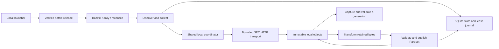

# SEC EDGAR local ingestion design

- **Status:** COMPLETE (2026-10-18). Approved by the owner on 2026-10-17 and implemented via `specs/plans/completed/1-sec-edgar-local-spec.md`; nothing deferred. Renewed offline acceptance and the separately reviewed genuine L12 adjudication are recorded in `specs/evidence/local-port/sec-acceptance.md`. Original genuine run/verification remain incomplete, exit 12; the supplemental result is separate. No historical-completeness claim.
- **Date:** 2026-10-17.
- **Destination:** `/Users/lowell/Projects/sec-edgar-local`.
- **Source baseline:** `/Users/lowell/Projects/sec-edgar`, commit `0e7701a1e2e98b669334546c90f5c9d4c45b1537`.
- **Selected by the owner:** native Python/uv execution, live SEC downloads, local storage, and a local-only fork. Azure support stays in the original project; neither Azure nor Docker is a prerequisite of this fork.
- **Scope of this document:** the design and acceptance contract for a later implementation plan. Writing this document does not implement ingestion or establish live-download success.

## 1. Outcome and boundaries

Build a standalone local application that acquires SEC filing-index originals, retains their exact bytes, transforms accepted rows, and publishes validated per-quarter Parquet generations. Reuse the source project's acquisition, coordination, workflow, ETL, approval, rollback, and captured-reader logic. Replace its cloud execution assumptions with native release provenance and local operating conventions.

The first supported host is this Mac: CPython 3.14, macOS arm64, a native filesystem with working SQLite locking and atomic filesystem operations. Retain `requires-python >=3.14`; record the exact interpreter used by each release. Linux support can follow a separate native validation run. Windows, network filesystems, and synchronized/shared data directories are outside the initial support contract.

The release must install, build, pass its complete default checks, and run without Azure SDKs, MSAL, Azure CLI, Bicep, Docker, or a container service. It uses the internet for explicit dependency setup and live SEC acquisition; acquisition never resolves or installs dependencies.

The initial scope includes manual backfill, daily catch-up, reconciliation, explicit approvals, rollback, history, and validated reads. It does not include a web interface, individual filing-document downloads, XBRL APIs, a new parser/deduplication policy, automatic scheduling, notifications, garbage collection, or migration of any existing store. A successful port does not establish complete historical coverage or an availability/capacity guarantee.

## 2. Decisions and alternatives

| Decision | Selected approach and consequence |
|---|---|
| Project boundary | A standalone local-only repository. Import selected runtime, tests, and required fixture bytes from the pinned source commit, recording their original paths and hashes. Do not import the original Git database or its entire generated evidence tree. The source project remains unchanged. Upstream fixes require deliberate review and import rather than automatic branch merges. |
| Python layout | Retain the uv workspace with one installable `packages/sec-edgar-ingest` member, import package `sec_edgar_ingest`, and existing `sec-edgar-ingest` command. Start the fork at package version `0.2.0` because its configuration and durable provenance contract change. Do not revive the three unused package scaffolds. |
| Storage and source selection | There is one storage backend, `local`. A separate `acquisition.mode` chooses `live` or `fixture`; storage locality no longer chooses the HTTP source. |
| Native provenance | Install a built wheel and exact dependencies into a separate, non-editable environment for each content-addressed native release. Use an explicit native runtime descriptor instead of a container image digest. |
| State compatibility | Start a fresh local store and use versioned local contracts. No Azure/old-fixture state import, compatibility alias for `image_digest`, or transparent registry rewrite. |
| Operation | Manual finite invocations with durable continuation. A launcher supplies correlation IDs, UTC deadlines, absolute paths, and logs. No automatic whole-worker relaunch or scheduler in the first release. |

Alternatives considered:

- Retaining Azure as an optional extra would reuse cloud tests, but would require two configuration, identity, and packaging paths. The owner selected a local-only fork, so the original project owns that compatibility surface.
- Running a local container would preserve image-digest semantics, but adds a runtime dependency the owner explicitly excluded.
- Rewriting ingestion around a simpler downloader would reduce inherited machinery, but would discard tested conditional updates, immutable worksets, fencing, result repair, and publication recovery. Reuse those guarantees and change their runtime boundary.

The code extraction is reversible by importing reviewed source changes. Durable format changes are harder to reverse after data exists; changes to the local contract require a new version and an explicit compatibility/migration design. This document does not supersede accepted records in the source repository.

## 3. Repository and source import

The destination starts as a design-only Git repository. Implementation later imports source files into that repository; it must not overwrite this spec or modify the original checkout. Record the baseline commit and a sorted original-path/destination-path/SHA-256 import manifest in `specs/evidence/source-import.json`.

The resulting layout is:

```text
sec-edgar-local/
  pyproject.toml                 # uv workspace; no cloud dependency constraints
  uv.lock                       # local-only dependency graph
  .python-version
  conf/                         # strict JSON configuration files
  packages/sec-edgar-ingest/
    pyproject.toml
    src/sec_edgar_ingest/
    tests/fixtures/              # self-contained synthetic and retained inputs
  scripts/                      # native release, launcher, and local check entry points
  docs/runbooks/                # setup, ingestion, recovery, and release upgrades
  specs/                        # this design, later plans, import/verification records
  data/                         # ignored; the default live store
  fixture-data/                 # ignored; fixture stores only
  logs/                         # ignored; launcher invocation and stream records
  releases/                     # ignored; wheels, locks, manifests, versioned environments
  .venv/                        # ignored; development and test environment
```

Copy only the retained SEC fixtures and provenance records actually consumed by the retained tests. The existing retained fixture manifest points into the source evidence tree, so copying the package tests alone is insufficient. Materialize those referenced bytes under the new fixture tree, verify original hashes, and write a local manifest with an explicit original-to-local path map. Preserve raw bodies exactly. Regenerate expected serialized application artifacts for the new contracts; do not relabel old evidence as a new verification run.

Exclude Azure infrastructure, deployment helpers, image build/smoke code, cloud-only tests/support, old plans, cached wheelhouses, `.venv`, `dist`, and initialized stores. The finished fork must build and run after the original source directory is made unavailable.

Keep Requests `2.34.2` and PyArrow `25.0.1` as the direct runtime pins initially. SQLite, JSON, hashing, multiprocessing, signals, and logging use the standard library. Preserve the supported uv build-backend range initially and record the exact backend/tool versions used in release evidence. Regenerate `uv.lock` for the retained dependencies; remove cloud-only requirements and constraints rather than blindly preserving the original transitive list. Ordinary port work does not authorize opportunistic upgrades of retained libraries.

## 4. Components and data flow



Retain the checked child-command boundary: a successful launch is not a successful command, and a pointer update alone is not proof of a finished publication. Workflows consume matching durable child results, preserve partial progress, and continue through the existing runner. Native child execution becomes release-aware as specified in section 6; it does not depend on a cloud orchestrator.

Keep separate responsibilities:

| Boundary | Responsibility |
|---|---|
| `config.py` | Strict local configuration parsing and validation without network/client construction. Keep configuration version separate from workset versions. |
| `storage/local.py` and `storage/contracts.py` | Filesystem objects, SQLite conditional state, finite leases, immutable binding, safe logical paths, and local object promotion. Remove cloud address/table routing. |
| `download.py` and `coordination.py` | Production HTTP child supervision, timing, retries, byte guards, shared pacing, ownership, cooldown, and cancellation. |
| `workflows/` | Checked child calls, retained selections/results, catch-up, reconciliation, and completion accounting. |
| `etl/` | Existing parser, immutable observations, candidate construction, validation, conditional publication, approval, rollback, and captured reads. |
| New `runtime.py` | Native runtime descriptor, manifest verification, and provenance equality. It neither selects SEC URLs nor mutates publication state. |
| New `release.py` | Build/install/verify one native release and produce its manifest. Used during explicit setup, outside ingestion. |
| New `local_cli.py` and a thin project launcher | Resolve local paths, select the pinned release, create invocation metadata, and delegate to that release's existing CLI. Keep ingestion business logic in the existing modules. |

Delete/exclude `storage/azure.py`, `storage/identity.py`, and `deployment.py`. Remove their configuration branches and imports instead of leaving an implicit cloud fallback.

## 5. Configuration and filesystem contract

Use strict JSON, preferably with a `.json` filename. Preserve duplicate-key, unknown-field, finite-number, and immutable-version validation. The default live file is `conf/sec-edgar-local.json`; fixture configurations are separate and explicitly labelled.

| Field or group | Local contract |
|---|---|
| `config_version` | Exactly `sec-local-config-v1`. Old acquisition configurations are refused. |
| `acquisition.mode` | Exactly `live` or `fixture`. |
| `storage.backend` | Exactly `local`. No account, endpoint, container, cloud table, or provider API-version fields. |
| `storage.root` | A local path; the default config uses `../data`. Absolute paths and `~` expansion are permitted. Relative paths resolve against the configuration file's parent, never the current working directory. |
| `runtime` | Live mode requires `kind=native` and `release_manifest`, an explicit manifest in `releases/sha256=<release-id>/release.json`, resolved by the same config-relative rule. A live config is prepared after its release exists. No mutable `latest` release reference. Fixture mode may instead select the explicit fixture provenance described in section 6. |
| `logging.root` | Default `../logs`, with the same path-resolution rule. Logs are supplementary; durable command results remain in the object store. |
| `backfill` | Initially preserve `start_quarter=2015Q1`, `end_quarter=open`. Resolve `open` once per invocation. A later explicit config revision can select the intended 2010Q1 range. |
| `daily.start_date` | Initially preserve `2026-10-01`; do not silently replace it with the installation date. |
| `sec` | Preserve the accepted owner User-Agent, default 3 requests/second, and one active collector. A lower positive rate is valid; never exceed the inherited budget. |
| `http` | Preserve five total attempts, 2-second base/120-second capped jittered retry delay while respecting longer server delays, 15/60-second connect/read timeouts, 90-second exchange limit, 67,108,864 received-byte and 536,870,912 expanded-byte limits. |
| `coordination` | Preserve namespace `sec-owner-lowell-mason`, finite 60-second leases, 20-second renewal, and 2-second uncertainty bound. |
| `etl` | Live parser `sec-index-parser-v1`, row schema `sec-index-v1`. Fixture parser aliases remain fixture-only. |
| `execution.max_run_seconds` | 3,600 for live commands; the convenience launcher's default timeout is 3,300 seconds. Only an explicit fixture deadline override can exceed this limit in fixture proofs. |
| `reconciliation.require_withdrawal_approval` | Always true. |
| `fixture` | Permitted only in fixture mode; clock/deadline overrides remain individually explicit. |

Remove `worker`, cloud `jobs`, and cloud `orchestration` settings. Do not add cloud configuration environment variables to the local public contract. Public commands read an explicit config file; the launcher supplies its default absolute path.

Configuration loading has two phases: validate the supplied document, then resolve every filesystem field against that document's original parent and normalize it to an absolute path. Canonicalize and hash this normalized effective configuration for command identity; retain the supplied byte hash separately for audit. The launcher writes this normalized configuration to its immutable invocation directory and dispatches that exact snapshot. Archived and child-command configurations both contain these normalized absolute paths. An archived snapshot therefore resolves identically on replay even though its own parent directory changed. Low-level commands apply the same normalization, which is idempotent for an already normalized snapshot.

Keep configuration path handling separate from logical object-key validation: object keys remain safe relative POSIX paths with the existing traversal/symlink defenses. Resolve and record the actual data root before store construction. Remove public `--state-dir`; tests create explicit temporary-root configs rather than applying a second root-resolution rule.

The local registry format is `sec-local-binding-v1`. It binds the resolved data root, acquisition mode, owner namespace, shared SEC policy, coordination policy, and local storage contract. Binding the mode prevents a fixture run from populating a live store. It excludes command IDs, historical selection range, parser version, and native release identity, so normal code/parser upgrades can use an existing store.

Objects live under `data/objects/<logical-key>`. `data/state.sqlite3` holds records, conditional publication pointers, queue/lease records, and the durable `sentinel_journal`; SQLite may also create WAL/SHM files. The sentinel object is not itself the pacing journal.

Use one live root for all invocations. A missing store is created by acquisition/workflow commands after validation. Operator commands open an existing store verify-only and refuse a missing or mismatched binding. Copying/moving an initialized root changes its binding and is unsupported in this version. Backups require stopped writers and a consistent SQLite backup plus matching immutable objects; never copy only the main SQLite file while writers are active.

## 6. Native release provenance

Development uses the project's `.venv`. Live acquisition runs from a non-editable wheel installation in `releases/sha256=<release-id>/venv`; it must not import application modules from the checkout or `PYTHONPATH`. Release setup can use uv, but the ingestion launcher executes the chosen environment's Python directly and never performs `uv sync`, dependency resolution, interpreter download, or package installation.

The release builder requires a clean committed implementation tree and a current locked dependency graph. It builds the application wheel, exports hash-bearing runtime requirements, selects/downloads artifacts only during explicit setup, and creates a fresh environment at its final path. Preserve the exact wheels needed for reconstruction in that release directory. A dependency/runtime change creates a new release; do not mutate an existing release environment while commands may use it.

The canonical `sec-native-release-v1` identity payload contains:

- application distribution name/version, native fork Git revision, and application wheel SHA-256;
- a sorted manifest of every wheel member under `sec_edgar_ingest/`, including runtime resources, with installed-relative filenames and hashes; exclude bytecode caches and installer-generated metadata, and verify the installed distribution name/version separately;
- the exact `uv.lock` SHA-256 and sorted runtime dependency inventory, including selected artifact hashes;
- CPython implementation, full interpreter version, cache tag, and platform/architecture tag.

`release_id` is the SHA-256 of the canonical identity payload, excluding its own digest, timestamps, absolute installation paths, and transient setup logs. Installation metadata/logs are separate. Build once and retain the wheel; this contract does not assert byte-identical wheel rebuilds from the same source.

The builder can determine the identity from the wheel payload, selected dependency artifacts, lock, and interpreter before creating the final environment, avoiding a self-referential path/hash or a moved virtual environment. After installation, it verifies application payload bytes, installed distribution versions, interpreter identity, and non-editable imports before marking the release usable. Installation must check the declared artifact hashes. Invocation preflight rechecks that usable release and its installed application payload/dependency inventory before any store mutation or network operation. An altered manifest, application payload, version inventory, missing artifact identity, or unsupported interpreter is a configuration failure.

The durable native runtime descriptor has exactly `format_version=sec-native-runtime-v1`, `kind=native`, and `release_sha256` (64 lowercase hexadecimal characters). Use it in `RunContext` and every artifact currently carrying `image_digest`; its release reference is a logical content identity, not an embedded absolute executable path. Retain the referenced immutable release manifest for audit. Do not reuse an all-zero digest, label native work as synthetic, or call a package digest a container image.

For deterministic fixture-only CLI/unit proofs, configuration may select `runtime.kind=fixture` and an explicit immutable `runtime.fixture_id`. Its descriptor has exactly `format_version=sec-fixture-runtime-v1`, `kind=fixture`, and `fixture_sha256`, computed as SHA-256 of canonical JSON with the single `fixture_id` field. This is synthetic provenance and is rejected in live mode. Fixture mode can also run in a verified native release for installed-wheel proofs. Keep fixture-pack identity separately in command intent as today. Do not require a release build for each unit test or permit test provenance to authorize live work.

Exact retries compare runtime identity as well as IDs, config, parser/schema, intent, and deadline. Preserve previous release environments and manifests so old attempts remain interpretable and exact retries can use their original runtime. Cached observations/generations retain the original producer descriptor; the current release must not overwrite cached provenance. Preserve the existing explicit force/reuse semantics and test that producer identity survives cache reuse. Changing only the native release must not manufacture a new observation or publication; parser/schema versions retain their existing semantic meaning.

Historical reads validate the saved descriptor and manifest without requiring that they equal the currently executing release. Operator commands verify their own native runtime and can inspect/approve/roll back generations made by an older release. Reading history needs its retained producer manifest, not execution of the old environment; executing an exact old attempt does require its pinned environment. This distinction prevents ordinary upgrades from making history unreadable.

For `runtime.kind=native`, checked child dispatch selects the release referenced by that child's pinned effective configuration and runs its Python as a supervised subprocess, including when parent and child use the same release. Keep matching durable calls/results as the authority. The parent captures the child's actual status and result identity and must not relaunch an ambiguous child. Collection of an older pending source and exact publication repair run under their saved origin/repair release; new transform/publish work uses the release specified by its current checked call. Preserve stored origin contexts and never substitute the parent's runtime to make an old call executable. A missing old environment is an explicit recovery/configuration failure, not permission to claim its identity from the current process. Tests must cover continuation and repair across two native releases.

For `runtime.kind=fixture`, checked children use the parent fixture interpreter as supervised subprocesses, preserving the synthetic descriptor, fixture pack, and network guard. They do not resolve or claim a native release; this route is refused in live mode. This permits deterministic fixture workflow proofs without release builds while preserving the same process/result boundary.

Virtual environments are created at their final location and recreated when relocating; Python documents their absolute interpreter paths and non-portability. See [Python's virtual environment documentation](https://docs.python.org/3.14/library/venv.html). uv's `--locked` checks lock freshness and `--no-editable` selects ordinary installations; development/release setup must use those semantics deliberately. See [uv locking and syncing](https://docs.astral.sh/uv/concepts/projects/sync/).

## 7. Durable formats and compatibility

The source uses several independent format constants, and acquisition `CommandResult` has no explicit outer version. Renaming one global constant is insufficient. Introduce these closed local formats wherever the envelope contains a changed context, effective configuration, or producer identity:

| Record family | Local format |
|---|---|
| Run context | `sec-local-run-context-v1` |
| Source/snapshot worksets | `sec-local-acquisition-v1` |
| Acquisition command result | `sec-local-command-result-v1` |
| Observation manifest | `sec-local-observation-v1` |
| Transformed workset | `sec-local-transformed-workset-v1` |
| Generation manifest | `sec-local-generation-v1` |
| ETL result | `sec-local-etl-result-v1` |
| Workflow result | `sec-local-workflow-result-v1` |
| Workflow selection | `sec-local-workflow-selection-v1`, retaining the current selection-v2 semantics |
| Checked child call | `sec-local-workflow-child-call-v1` |
| Workflow member receipt / evidence | `sec-local-workflow-member-receipt-v1` / `sec-local-workflow-member-evidence-v1` |
| Workflow parent recovery / provenance | `sec-local-workflow-parent-recovery-v1` / `sec-local-workflow-parent-provenance-v1` |
| Workflow member provenance / completion capture | `sec-local-workflow-member-provenance-v1` / `sec-local-workflow-completion-v1` |
| Workflow repair obligation / resolution / authority | `sec-local-workflow-repair-obligation-v1` / `sec-local-workflow-repair-resolution-v1` / `sec-local-workflow-repair-authority-v1` |
| Legacy publication repair descriptor | `sec-local-workflow-legacy-publish-v1`, retaining publication-repair semantics, not old selection-format compatibility |

Every residual durable workflow envelope containing context/provenance, whether already versioned or unversioned, additionally requires `contract_version=sec-local-contract-v1`. This covers intent, membership, processing, proof, and any wrappers not named above; an absent/wrong marker is refused. Preserve publication recovery even though old workflow-selection compatibility is removed. The implementation plan must inventory every writer, strict-key reader, hash calculation, and equality check for these families. Version the config independently of source/snapshot worksets. Remove the old workflow-selection legacy reader; prove old contracts are refused without modifying store contents.

Keep unchanged SEC URL/source identities, raw body hash addresses, `sec-index-v1` rows, parser/envelope identifiers, and approval/activation/rollback record shapes whose payload contracts do not change. References to generations naturally receive new hashes. A new store and its registry prevent accidental mixing with original stores. No existing source evidence or old registry bytes are rewritten.

## 8. Live acquisition, fixtures, and coordination

In live mode, acquisition uses the existing real `BoundedSender`, canonical SEC HTTPS URL checks, request policy, spool files, and independently supervised child deadline. A fixture pack, fixture clock/deadline marker, or fixture parser is rejected before store construction. Transform/publish consume retained immutable references and do not instantiate a collector.

In fixture mode, acquisition requires an explicit validated fixture pack and uses only its recorded responses. Missing/exhausted responses never fall back to the SEC. Fixture clock/deadline overrides remain opt-in. Both modes use the same local persistence implementation, with distinct bound roots.

Preserve one shared local coordinator for discovery, collection, retries, and reconciliation; do not remove leases because the application runs on one computer. Retain conditional updates, finite ownership, fencing, request spacing, server cooldowns, and positive confirmation that an HTTP child drained before releasing unsafe ownership. Interruption or uncertain shutdown must leave conservative recovery evidence.

The inherited 3-request/second budget is stricter than the SEC's current published ceiling; keep it. SEC guidance requires a declared User-Agent and applies its user-level ceiling across machines. See [SEC Developer Resources](https://www.sec.gov/about/developer-resources) and [Accessing EDGAR Data](https://www.sec.gov/search-filings/edgar-search-assistance/accessing-edgar-data).

Separate local roots and the original Azure deployment do not share leases or pacing journals. The operating contract permits only this one live issuer during local runs; other collectors for the same accepted project budget must be stopped externally. The local launcher must not claim it can verify or stop Azure. Multiple native commands sharing the same live root remain coordinated locally.

Retain the current dispatch/start-window policy initially. The source deferred list records possible native child-start latency exceeding its approximately one-third-second permit at 3 requests/second. Measure startup/dispatch behavior in native verification and record `permit_expired` outcomes. A safely refused expired permit is an explicit deferral, not itself a pacing/correctness violation. A timing/ownership invariant violation, or inability to make the required progress within bounded acceptance attempts, blocks readiness and requires a reproducing test and reviewed correction. Do not silently widen production timing to make a smoke run pass.

## 9. Commands and operating behavior

Retain the low-level console/module commands: `discover`, `collect`, `transform`, `publish`, `backfill`, `daily`, `reconcile`, `candidates`, `approve`, `history`, and `rollback`. Keep explicit low-level run/execution/attempt IDs and aware UTC deadlines. Execution IDs are native correlation IDs, with no cloud environment source. Remove `--config-env` and provider identity arguments from the local public contract.

The project launcher `scripts/sec-edgar-local` accepts a workflow command (`backfill`, `daily`, or `reconcile`), optional `--config PATH`, and optional `--timeout-seconds N`. It defaults to the project's live config using its own location, validates `0 < N <= execution.max_run_seconds`, resolves the immutable release, and delegates to its Python with inherited import-path overrides removed. Its default is 3,300 seconds. It generates safe unique run/execution/attempt IDs and records the effective paths, exact argv, IDs, UTC start/deadline, normalized effective config snapshot/hash, original config byte hash, and native release identity before dispatch. The delegated `--config` names that normalized snapshot, not the source config. A separate immutable invocation file under `logs/<run-id>/<attempt-id>/` supports manual exact replay; the launcher never overwrites an existing invocation.

Preserve the CLI's single JSON stdout result and structured stderr events. Retain both streams under that invocation's log directory. Failure to prepare the invocation/config/log files aborts with exit 2 before engine dispatch. After dispatch, drain/supervise the bounded engine even if a log sink fails; never relaunch it. The wrapper returns the actual engine exit status when logging succeeds, and exit 9 for a required logging failure after dispatch, recording the actual engine status separately in a launcher stderr event wherever output remains possible. The durable engine result is unchanged by a wrapper log failure. Interrupts are forwarded to the engine and its supervised children. The log record is not authoritative command completion: only the matching durable engine result is.

Normal new workflow invocations receive new IDs and continue unresolved durable source/quarter work. An exact retry uses the archived config, original native release, same IDs/intent/deadline, and low-level argv. A completed exact result can replay after its deadline. An unfinished expired attempt requires a new attempt; preserve its original evidence. Backfill therefore proceeds in bounded resumable runs rather than an unbounded worker process.

Keep existing outcome distinctions and exit codes: 0 success/no-new/unchanged; 2 configuration/refused input; 3 incomplete/discovery failure; 4 pending; 5 retry/deferred/throttled; 6 access blocked; 7 quarantined/invalid source; 8 lost ownership; 9 state/internal/publication conflict; 10 awaiting approval; 11 stale approval/rollback. Do not convert pending, gated, or partially published work into success.

Operator commands use the same config/root and verified runtime. `approve` requires explicit `--approver`; `rollback` requires explicit `--operator` and reason. These are local audit labels, not authenticated identity assertions. Preserve exact-candidate approvals, first-approval semantics, recorded rollback, and verify-only store opening. Preserve `capture_quarter` followed by `read_quarter`; consumers must not glob Parquet files to infer the current generation.

There is no automatic scheduling or notification in this scope. Documentation can explain invoking the launcher manually; later scheduling must use the same root, finite deadlines, and explicit operating contract.

## 10. Data-quality behavior and recovery

Retain source-level quarantine, strict supported-family parsing, duplicate-conflict refusal, manifest validation, publication CAS, post-pointer result repair, approval gates, and immutable rollback records. Do not introduce a duplicate winner, a zero-row exception, or a force bypass during this port.

The source evidence contains 51 conflicting observations across retained 2010Q1, 2015Q1, and 2026Q3 specimens. Their accepted whole-source quarantine remains a regression case; it does not become valid rows or a successful publication in the local fork. Fixing historical coverage is a separate data-policy decision. A live acceptance record must state the actual observed outcome, even when acquisition succeeds and ETL quarantines a source.

Retain immutable raw objects, release manifests, generations, approvals, and results. Disk exhaustion, SQLite contention, corrupt/missing objects, clock uncertainty, and uncertain child shutdown must produce explicit failure/recovery evidence. Document stopping writers, replaying the matching attempt, continuing with a new attempt when required, and verifying publication repair. No automatic cleanup removes evidence to recover space.

## 11. Azure-free verification strategy

Use the verification-before-completion discipline: every passing claim identifies the command, environment/release, and fresh output. During implementation, write failing local contract tests before library/pipeline changes. A later implementation plan must apply `develop-testing-strategy` to the port's data/process tests before changing them.

The complete default check runs native tests under a cloud-independent network guard, builds wheel/sdist, exercises console/module entry points and help, compiles sources, and checks the diff. It does not render ADF, compile Bicep, run images, import cloud SDKs, or require the original repository. Guard external sockets and DNS before test imports; retain exact selected loopback origins and propagation into both checked stage subprocesses and their spawned HTTP children, including cross-release proofs. Adapt fault injection and supervision tests to that process boundary through test support, not a production fixture-bypass flag. Do not disable the network guard to make imports succeed.

Remove cloud-only files from the fork's suite. Split mixed local/cloud tests so the local conditional-state, contention, crash, approval, large-candidate, captured-reader, and workflow assertions remain. Update installed-wheel proofs and dependency inventory checks to use this fork's own lock, release artifacts, and declared cache. Historical Stage 2 wheel directories and old fixed dependency counts must not be prerequisites.

Default verification is offline after dependency setup. A production-transport/local-store integration test uses an explicitly selected loopback origin confined to test support; no user-configurable endpoint rewrite is added to live configuration. The production runtime always retains canonical SEC origin enforcement.

Required acceptance cases:

| ID | Passing evidence |
|---|---|
| L01 | A fresh native environment installs the wheel and locked runtime graph with no Azure/MSAL dependencies. Wheel contents, lock/export, and installed inventory confirm this; cloud tools are absent from the check environment. |
| L02 | All intended local tests are discovered and pass without cloud imports or broad cloud-dependent skips. Required retained fixture bytes are self-contained and hash-verified. |
| L03 | All command help, module/console entry points, and the installed-wheel workflow work outside both source checkouts, without `PYTHONPATH`. |
| L04 | Config-relative roots resolve identically from arbitrary working directories; invalid configs/fixture overrides fail before state creation/network work. |
| L05 | Live transport plus local stores is exercised through bounded test-only loopback HTTP. Fixture mode requires its pack and cannot fall back to live requests; fixture/live store mixing is refused. |
| L06 | SQLite reopen, constructor contention, stale CAS, immutable collisions, crash boundaries, finite leases, fencing, pacing/cooldown, and drain/recovery guarantees pass native process tests. |
| L07 | Fixture discover/collect/transform/publish, backfill/daily catch-up, reconcile, approval, rollback, and captured reads pass with local contracts and exact durable results. |
| L08 | Changed release identity/config/IDs/intent/deadline refuses an exact retry. Completed replay and unfinished-expired continuation follow their distinct contracts. |
| L09 | Native manifest, installed app, dependency version, and interpreter tampering/mismatch is refused before writes/HTTP. Cached artifacts preserve their actual original producer. |
| L10 | Local format round-trips and strict fields are tested across every changed record family. Old image-based contracts and old bindings are refused without mutation. |
| L11 | The launcher records invocation/config/runtime, preserves JSON stdout and structured stderr, follows the specified engine/log-failure status precedence, forwards signals, and never syncs/installs dependencies during a run. Pre-dispatch and post-dispatch logging failures have separate tests. |
| L12 | A separately recorded, explicitly selected genuine SEC smoke proves actual native acquisition, persistence, restart/reuse, and at least one accepted genuine source through transform, publication, capture, and validated nonempty read. Record counts, source/generation identities, and expected quarantines separately. It uses the same release, coordinator, and canonical production transport, not a fixture-path bypass. |
| L13 | Two native releases share a store across an upgrade: current-release commands can read old history/approve/roll back; old-origin pending collection and exact repair execute under the referenced old environment; cached producer identity remains unchanged. Missing old-runtime execution fails explicitly without provenance substitution. |

L12 is not part of the default offline check. Its later run must record an exact bounded source/date range, request/attempt and time/byte bounds, release/config identity, sole-issuer arrangement, and retained results before execution. Use one archived quarter with a small daily/catch-up range rather than the entire default historical backfill. If every selected genuine source quarantines or no accepted source completes publication and validated read, L12 is incomplete; record the outcomes and revise the bounded selection explicitly instead of weakening parsing or declaring success. No genuine SEC data is downloaded while authoring this spec. Offline passing cases do not imply L12, complete historical coverage, or correction of known quarantines.

## 12. Implementation boundaries and handoff

The implementation plan should order work by dependencies, with a verification checkpoint after each milestone:

1. Record the source import and self-contained fixture corpus; establish the local-only package/lock and baseline local test discovery.
2. Implement native release provenance and the complete versioned local record contract, including cache/retry semantics.
3. Implement config-relative local storage and independent live/fixture selection; preserve coordination and operator behavior.
4. Add the native launcher, release setup/reconstruction procedure, current runbooks, and Azure-free complete checks.
5. Run fresh native/isolated-wheel verification, review the implementation, and record the bounded genuine-source acceptance separately.

This is a design, not a task-by-task implementation plan. The plan must assign files, tests, and review boundaries using the actual imported code; it must not execute the original project's Azure Stage 7 plan. Existing source plans and live deployment approvals do not transfer to this fork.

Before planning, the owner reviews this written spec. Once approved, use `writing-plans` in a fresh session with this file and the pinned source baseline as the handoff. The new plan must be self-contained and preserve the local-only/no-Docker boundary. The spec contains no unresolved implementation-policy choice: scheduling, old-state migration, Windows/shared filesystems, and duplicate-resolution changes are deliberately outside scope.

## 13. Source references and evidence status

These findings were checked against the pinned source, not an assumed cloud deployment:

- [Local storage factory](/Users/lowell/Projects/sec-edgar/packages/sec-edgar-ingest/src/sec_edgar_ingest/storage/__init__.py:15) and [immutable local binding](/Users/lowell/Projects/sec-edgar/packages/sec-edgar-ingest/src/sec_edgar_ingest/storage/contracts.py:163).
- [Fixture/live CLI coupling](/Users/lowell/Projects/sec-edgar/packages/sec-edgar-ingest/src/sec_edgar_ingest/cli.py:127) and [checked workflow dispatch](/Users/lowell/Projects/sec-edgar/packages/sec-edgar-ingest/src/sec_edgar_ingest/workflows/checked.py:393).
- [Image-based context](/Users/lowell/Projects/sec-edgar/packages/sec-edgar-ingest/src/sec_edgar_ingest/models.py:314), [context pinning](/Users/lowell/Projects/sec-edgar/packages/sec-edgar-ingest/src/sec_edgar_ingest/config.py:281), and [independent ETL formats](/Users/lowell/Projects/sec-edgar/packages/sec-edgar-ingest/src/sec_edgar_ingest/etl/contracts.py:17).
- [Production parser](/Users/lowell/Projects/sec-edgar/packages/sec-edgar-ingest/src/sec_edgar_ingest/etl/parser.py:14) and [quarantine acceptance record](/Users/lowell/Projects/sec-edgar/specs/evidence/sec-filing-index-ingestion/stage-3/verification.md:3).
- [Current cloud-coupled checks](/Users/lowell/Projects/sec-edgar/scripts/check-sec-edgar-ingest.sh:1), [test network guard](/Users/lowell/Projects/sec-edgar/packages/sec-edgar-ingest/tests/network_guard.py:110), and [deferred timing issues](/Users/lowell/Projects/sec-edgar/specs/deferred_items.md:442).

The preceding architecture assessment ran 12 configuration tests and 14 local-storage tests successfully, checked CLI help, and reproduced the missing-fixture refusals. Those are source-baseline observations; none is acceptance evidence for an implemented local fork. This design session performs document/source verification only, with no application implementation, dependency installation, live SEC acquisition, or cloud/Docker action.
