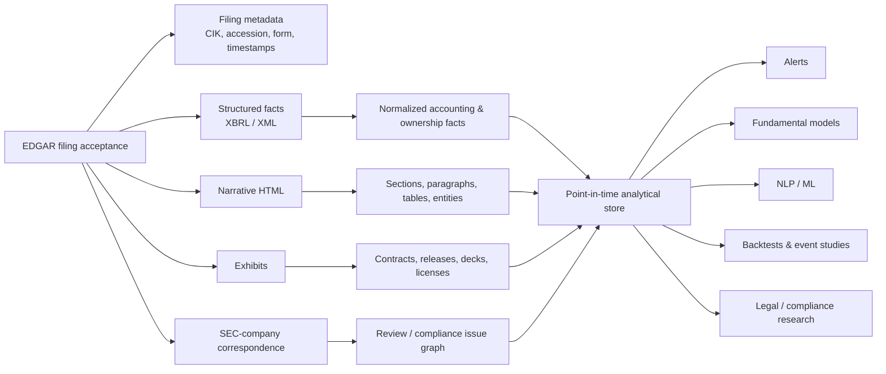
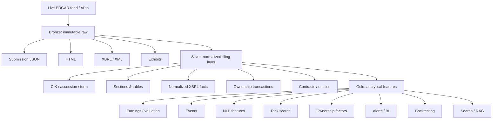
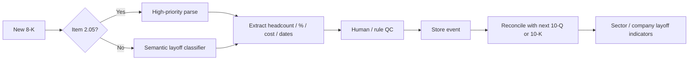
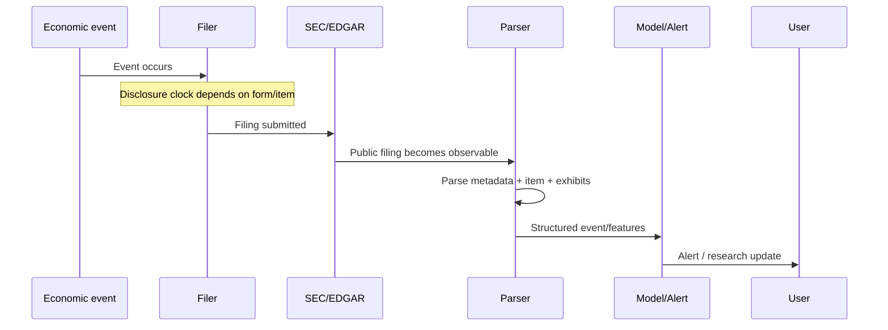
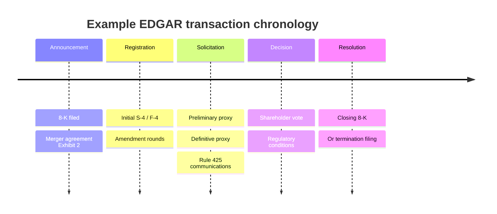

# SEC EDGAR as a Research and Decision System: A Comprehensive Use-Case Catalog

## Executive summary

SEC EDGAR is best understood not as one database but as a **public, point-in-time disclosure system containing several distinct data regimes**: structured XBRL financial facts; semi-structured HTML narrative filings; XML ownership and fund reports; registration statements and transaction documents; exhibits such as contracts, credit agreements, press releases, and licenses; SEC-company correspondence; and specialized structured datasets for insiders, institutional holdings, funds, private offerings, and asset-backed securities. The SEC exposes much of this through `data.sec.gov` APIs, bulk archives, filing indexes, full-text search, RSS/latest-filings feeds, and downloadable DERA datasets. The APIs update throughout the day, while the principal bulk submissions and Company Facts archives are rebuilt nightly; automated users are expected to identify themselves and remain within the SEC's fair-access limit of 10 requests per second. citeturn0search0turn8search19turn0search3

That architecture makes EDGAR useful for far more than conventional fundamental analysis. In practice, it supports at least five broad analytical families:

| Analytical family | High-value applications | Primary EDGAR material |
|---|---|---|
| **Fundamentals and valuation** | earnings analysis, financial modeling, accounting quality, tax, credit, benchmarking, quantitative factors | 10-K, 10-Q, 20-F, XBRL facts and notes |
| **Corporate events and ownership** | layoffs, M&A, restructurings, defaults, insider trades, activist campaigns, executive turnover | 8-K, Forms 3/4/5, 13D/G, S-4/F-4, proxy/tender documents |
| **Text and competitive intelligence** | sentiment, disclosure novelty, product-market mapping, supply-chain risk, patents/licenses, legal discovery | 10-K/10-Q narrative, exhibits, CORRESP/UPLOAD, registration statements |
| **Market structure and capital formation** | institutional positioning, IPOs, private fundraising, fund portfolios, proxy voting, ABS credit | 13F, S-1/F-1/424B, Form D, N-PORT, N-CEN, N-PX, ABS-EE/10-D |
| **Surveillance and risk** | fraud screens, restatements, internal-control monitoring, cybersecurity, ESG, regulatory/compliance alerts | 8-K Items 1.05/4.02, 10-K Item 9A, Form SD, staff correspondence |

The strongest EDGAR systems combine **three layers rather than choosing between structured data and NLP**. First, extract filing metadata and XBRL/XML deterministically. Second, segment narrative disclosures and exhibits into well-defined sections. Third, apply NLP or machine learning only after identities, dates, amendments, document types, and accounting periods have been normalized. This sharply reduces false signals caused by boilerplate, duplicate facts, amended filings, tables, or an LLM confusing the filing date with the accounting period. SEC Financial Statement and Notes datasets are especially useful because they expose both numeric and textual structured information as filed; the SEC also provides separate datasets for insider transactions, 13F holdings, Form D offerings, N-PORT holdings, and other specialized domains. citeturn8search0turn8search4turn2search6turn5search3turn8search2turn8search3

A second crucial point is **latency discipline**. EDGAR is point-in-time only if the researcher keys information to the public acceptance timestamp, not merely the fiscal-period end or transaction date. An 8-K generally appears within four business days of the triggering event; Form 4 reports normally follow insider transactions within two business days; 13F information can be roughly six weeks stale because managers normally have 45 days after quarter-end; and periodic reports arrive weeks after their accounting periods. citeturn17search15turn22search0turn2search9 Consequently, a trading backtest, event study, credit-monitoring system, and historical fundamental database should all preserve at least `event_date`, `period_end`, `filing_date`, `acceptance_datetime`, `accession_number`, and amendment status.

The third major conclusion is that **EDGAR is strongest when treated as a system of linked evidence**. A restructuring signal becomes more reliable when an 8-K Item 2.05 is reconciled to severance charges in the next 10-Q. An M&A record improves when the 8-K merger announcement, merger agreement exhibit, S-4/F-4, proxy, amendments, and closing 8-K are connected. An insider signal improves when grants and tax-withholding transactions are separated from genuine open-market purchases. A fraud model improves when accounting ratios are combined with restatement notices, internal-control weaknesses, auditor changes, disclosure-language changes, and SEC comment correspondence rather than treating a statistical F-score as an allegation. citeturn17search11turn18search2turn15search27turn9search23

Finally, the regulatory schema itself is not static. As of October 20, 2026, the SEC has **proposed**, rather than finalized, an optional semiannual reporting regime that would permit a new Form 10-S in place of quarterly 10-Q reporting for electing companies. citeturn20search0turn20search1 Likewise, the 2024 climate-disclosure rules remain stayed, the SEC stopped defending them in court in 2025, and in 2026 proposed their rescission; the rescission remained a proposed rule on the SEC's rulemaking materials. citeturn12search0turn12search1turn12search8 A production EDGAR platform therefore needs a **versioned form/schema layer**, not hard-coded assumptions that a particular filing regime will remain unchanged indefinitely.

## EDGAR data map and source hierarchy

The most useful starting point is to map **question → disclosure obligation → form/item → document/exhibit → extraction mode**.

| Form or source | What it contributes | Particularly useful fields/items | Typical latency profile |
|---|---|---|---|
| **10-K** | audited annual fundamentals and comprehensive narrative disclosure | Item 1 business; 1A risks; 1C cybersecurity; MD&A; financial statements/notes; Item 9A controls; exhibits | annual, weeks after fiscal year end; detailed rather than ultra-low latency |
| **10-Q** | interim financials and changes since annual filing | financial statements/notes, MD&A, legal/risk updates, controls | currently quarterly for covered domestic issuers; policy may change if the pending semiannual proposal is adopted |
| **8-K** | material corporate events | 1.01 agreements; 1.03 bankruptcy; 1.05 cyber; 2.01 acquisitions/dispositions; 2.02 results; 2.03 obligations; 2.04 defaults; 2.05 restructuring; 2.06 impairments; 4.01 auditor; 4.02 non-reliance; 5.02 management; 7.01 Reg FD; 8.01 other; 9.01 exhibits | most reportable events within four business days |
| **20-F / 6-K** | foreign-private-issuer annual/current disclosures | financials, risks, material developments, exhibits | issuer/jurisdiction dependent; included in SEC XBRL/API coverage |
| **Forms 3/4/5** | insider ownership and transactions | security, transaction date/code, amount, price, acquisition/disposition, post-trade holdings, direct/indirect ownership, derivatives | Form 4 usually within two business days |
| **Schedule 13D / 13G** | >5% beneficial ownership | stake, reporting persons, source of funds, Item 4 purpose, agreements and amendments | event-driven; 2023 modernization accelerated deadlines and introduced structured filing requirements |
| **13F-HR** | institutional long positions in reportable securities | issuer, class, CUSIP, value, shares/principal amount, voting discretion | quarterly, generally up to 45 days after quarter-end |
| **S-1/F-1 + 424B4** | IPO diligence | financials, capitalization, dilution, use of proceeds, risks, underwriters, selling shareholders | iterative amendments before pricing; final prospectus around offering |
| **S-3/F-3 + 424B5** | follow-on and shelf offerings | offering terms, dilution, use of proceeds, securities structure | event-driven |
| **S-4/F-4, merger proxies, 425** | M&A mechanics | consideration, exchange ratio, forecasts if disclosed, fairness analysis, merger agreement, background, synergies, votes | from announcement through closing |
| **DEF 14A / PREM14A** | governance and executive compensation | board, ownership, compensation tables, pay ratio/pay-versus-performance, proposals, related-party matters | annual or transaction/event driven |
| **Form SD** | specialized supply-chain/resource disclosures | conflict-minerals/resource-extraction information | periodic |
| **UPLOAD / CORRESP** | SEC comment letters and company responses | staff questions, accounting/disclosure issues, company explanations | correspondence cycle, often after filing review |
| **Form D** | exempt private offerings | issuer, offering type, amount offered/sold, investor information and related metadata | event-driven |
| **N-PORT / N-CEN** | registered-fund portfolio and operational data | holdings, derivatives/exposures, fund characteristics | monthly/annual reporting regimes |
| **N-PX** | proxy voting by funds and certain managers | issuer, ballot matter, vote, management recommendation and categories | annual; fund records cover the year ended June 30 |
| **ABS-EE / 10-D** | securitization analysis | asset-level data and distribution/performance information | periodic |
| **Form 144** | intended affiliate/restricted-security sales | seller, securities and proposed transaction | event-driven; certain Form 144 filings have been electronic on EDGAR since 2023 |

The core periodic-report contents are specified by the SEC's 10-K and 10-Q forms, while the 8-K provides the event taxonomy for current reporting. citeturn0search9turn0search14turn17search15 The SEC specifically identifies Item 2.05 with exit/disposal plans—including qualifying employee-termination plans—and Item 1.05 with material cybersecurity incidents; cyber Item 1.05 disclosure is generally due within four business days after the registrant determines that the incident is material. citeturn17search11turn3search1turn3search5

Form 4 is unusually machine-friendly: filings expose transaction date, transaction code, acquisition/disposition indicator, transaction amount and price, post-transaction beneficial ownership, direct/indirect ownership, and a second table for derivative instruments. SEC transaction code `P` represents an open-market or private purchase and `S` an open-market or private sale; codes such as `A`, `F`, and `M` represent grants, tax/consideration withholding, and option/derivative exercise or conversion and therefore should not be naively treated as discretionary insider buying or selling. citeturn18search12turn18search2

Schedule 13D is similarly rich in intent: Item 3 covers sources and amounts of funds, Item 4 the purpose of the transaction, Item 5 the interest in securities, and Item 6 contracts or arrangements. That makes it far more analytically useful for activism than merely observing that ownership exceeded 5%. citeturn17search9turn17search21 The SEC's modernization of beneficial-ownership reporting shortened important 13D/13G deadlines and introduced structured-data requirements, so historical pipelines must respect regime changes rather than applying today's timing to old filings. citeturn2search4

Form 13F gives a different perspective: it shows reportable long holdings of institutional investment managers, but the statutory reporting lag means it should be interpreted as a **delayed portfolio snapshot rather than a live book**. Managers may also receive confidential treatment for certain positions, including qualifying open risk-arbitrage or ongoing acquisition/disposition programs, further limiting attempts to infer complete current portfolios. citeturn2search9turn18search14

Transaction and offering documents contain information that rarely appears cleanly in financial APIs. S-4 is expressly designed for securities issued in mergers, exchange offers, and related transactions. citeturn21view0 IPO prospectuses can expose offering price, shares sold, dilution, selling-holder proceeds, lock-ups, capitalization, and use-of-proceeds information. citeturn14search3turn14search23 Material contracts are often filed as exhibits pursuant to Regulation S-K Item 601, although legitimately confidential, nonmaterial, competitively harmful portions can be redacted subject to the applicable rules. citeturn9search12turn9search20

For ingestion, there are four particularly important official paths:

1. **Submissions API** for filing histories and metadata.
2. **Company Facts/XBRL APIs** for standardized facts and cross-company frames.
3. **EDGAR archives/latest filings/full-text search** for documents and event discovery; the current full-text search covers electronic filings dating back to 2001.
4. **DERA structured datasets** for research-scale extraction of financial statements/notes, insider transactions, 13F, Form D, registered funds, and other form families. citeturn0search0turn17search18turn8search0turn8search4turn2search6turn5search3

A robust internal representation therefore looks less like a spreadsheet and more like a temporal data graph:



This separation follows the SEC's own distinction between submissions metadata, XBRL data, raw filing documents and specialized structured datasets. citeturn0search0turn8search4

## Comprehensive use-case catalog

The tables below treat a **use case** as an analytical workflow rather than merely a document search. “Latency” means how quickly the source is useful after the underlying economic event, not simply how quickly HTTP retrieval is possible.

**Fundamental, earnings, valuation, and quantitative research**

| Use case | EDGAR forms and fields | Typical methods / algorithms | Cadence and latency | Metrics / output and example workflow | Representative sources |
|---|---|---|---|---|---|
| **Earnings themes and KPI analysis** | 8-K Item 2.02, EX-99 earnings release; 10-Q/10-K MD&A; XBRL statements and notes; 7.01 decks | XBRL normalization, KPI regex/schema extraction, topic models, embeddings, QoQ/YoY text diff, management-language classification | event-driven earnings release; 10-Q/10-K often follows or overlaps | revenue/margin bridges, KPI surprises, emerging themes, guidance-language changes. Ingest 8-K → extract release → reconcile reported GAAP numbers to XBRL → compare narrative with prior quarter | 8-K is an SEC current-report channel; academic work warns that periodic-filing event reactions can be confounded when earnings are first disclosed elsewhere. citeturn17search15turn16search7 |
| **Sentiment, uncertainty and tone** | 10-K/10-Q risk factors and MD&A; 8-K; S-1; 20-F | Loughran-McDonald dictionary, sentence classifiers, FinBERT-like models, embeddings, negation-aware scoring | periodic/event-driven; no need for millisecond latency unless trading the filing | positive/negative/uncertainty/litigiousness ratios, tone change, section-level heatmaps | Loughran & McDonald showed that generic dictionaries can misclassify financial language and developed domain-specific word lists tied to 10-K outcomes. citeturn15search4turn15search8 |
| **Readability and complexity** | 10-K/10-Q narrative, especially MD&A | Fog-style readability, document length, syntax complexity, table density, vocabulary entropy | annual/quarterly | readability percentile, year-over-year complexity delta, peer comparison | Li's 2008 research links annual-report readability to contemporaneous performance and earnings persistence; subsequent work commonly builds on this family of measures. citeturn15search21 |
| **Disclosure novelty / change detection** | consecutive 10-Ks/10-Qs, individual sections | cosine/Jaccard similarity, TF-IDF, MinHash, embeddings, sequence alignment | immediately upon new filing | `novelty = 1 - similarity`; changed-sentence extraction; change attribution by section | *Lazy Prices* studies changes in recurring SEC filing language and documents predictive information in those changes; use as a methodological precedent, not a guarantee of future alpha. citeturn18search0 |
| **Quantitative factor construction** | XBRL financials plus Forms 4, 13F, 13D/G, filing text | profitability, accruals, investment/asset growth, leverage, issuance, quality, filing-language change, insider net purchases, ownership change | quarterly/annual for fundamentals; faster for ownership/events | cross-sectional z-scores, decile portfolios, composite “quality/change/ownership” factors | EDGAR provides the raw financial, insider and holdings components; text-change and insider-classification research gives examples of transforming filing content into signals. citeturn8search0turn2search6turn5search3turn18search0turn16search5 |
| **Valuation modeling** | XBRL income/cash flow/balance sheet; debt, leases, stock comp, tax and segment notes; S-1/424; proxy dilution data | DCF, residual income, EV/revenue or EV/EBITDA comps, segment SOTP, scenario analysis | update after 10-Q/10-K and material 8-Ks | normalized revenue/margin/FCF, net debt, diluted shares, DCF range, sensitivity matrices | SEC XBRL APIs and Financial Statement/Notes datasets provide the core accounting inputs; market prices, betas and WACC usually require external data. citeturn0search0turn8search4 |
| **Peer benchmarking** | XBRL, 10-K Item 1, segment notes, human-capital disclosure, DEF14A | taxonomy harmonization, peer clustering, percentile ranks, unit economics, text similarity | quarterly/annual | margin percentile, R&D intensity, working-capital days, headcount productivity, peer narrative similarity | Hoberg and Phillips derive dynamic competitors from similarities in 10-K product descriptions, showing why filing-based peers can complement SIC/NAICS peer groups. citeturn15search2turn15search18 |
| **Accounting and tax analysis** | statements/notes, accounting policies, income-tax note, 8-K 4.01/4.02, comment letters | ETR reconciliation, cash-vs-book tax, deferred-tax analysis, reserve changes, accounting-policy diffing, restatement tracking | quarterly/annual plus event alerts | effective tax rate, valuation allowance, uncertain-tax-position changes, policy changes, restatement flags | Detailed statement-and-note XBRL data permit fact-level work beyond face financials; SEC correspondence adds review context. citeturn8search4turn9search23 |

A practical distinction matters here: **EDGAR-only factors are possible, but EDGAR-only portfolio research usually is not**. Return-based factors, market capitalization, intraday reactions, bid-ask effects, analyst surprises and cost-of-capital estimation require point-in-time market or analyst data from elsewhere. Filing acceptance timestamps should be used to join those external datasets so the model never uses information before it became public. An EDGAR header explicitly carries an `ACCEPTANCE-DATETIME`, illustrating why filing-day rather than fiscal-period timestamps belong in the research schema. citeturn14search12

**Corporate events, ownership, and capital-markets intelligence**

| Use case | EDGAR forms and fields | Typical methods / algorithms | Cadence / latency | Metrics / workflow | Representative sources |
|---|---|---|---|---|---|
| **Layoff and restructuring tracking** | 8-K 2.05; 10-K/10-Q restructuring/severance notes; human-capital disclosures | Item filter, regex/NER for employees/percentages/costs/sites, classifier for closure vs workforce action, subsequent-quarter reconciliation | 8-K generally within days when Item 2.05 is triggered; some layoffs never create an Item 2.05 filing | employees/percent cut, expected charges, cash/noncash cost, geography, announced completion date; aggregate into sector layoff breadth | SEC says Item 2.05 encompasses qualifying exit/disposal commitments and employee-termination plans; real filings may quantify workforce and charges. citeturn17search11turn11search3turn11search5 |
| **M&A detection and deal analysis** | 8-K 1.01/2.01; merger-agreement exhibits; S-4/F-4; PREM/DEFM14A; Schedule TO; 425; 13D amendments | entity linking, transaction-term extraction, consideration parser, timeline graph, text comparison across amendments | announcement to closing; multiple updates | price, stock/cash mix, exchange ratio, termination fee, approvals, synergies, financing, closing probability, competing bids | Form S-4 expressly covers securities issued in mergers and exchange offers; M&A product-market analysis has also used 10-K text similarity. citeturn21view0turn15search18 |
| **Insider trading analytics** | Forms 3/4/5 XML | transaction-code filters, dollar-value normalization, cluster detection, insider-role weighting, routine/opportunistic classification | typically within two business days for Form 4 | open-market net buying, buy clusters, ownership delta, role-adjusted conviction, planned-vs-discretionary trade features | SEC Form 4 provides transaction codes and detailed holdings fields; Cohen, Malloy & Pomorski distinguish historically less-informative routine activity from opportunistic trades. citeturn18search2turn18search12turn16search5 |
| **Activist campaigns** | Schedule 13D/A, 13G changes, exhibits/letters, DEF14A, PREC14A, DEFC14A | ownership-event detection, Item 4 intent classification, NLP of demand letters, campaign-state machine | event-driven, subject to beneficial-ownership reporting deadlines | stake %, cost basis/source of funds, board demands, strategic demands, settlement/proxy-fight status | Item 4 is the key purpose-of-transaction field. Brav et al.'s classic study uses Schedule 13D activism data and documents campaign characteristics and historical announcement reactions. citeturn17search21turn17search4 |
| **Institutional ownership / “smart money”** | 13F-HR and amendments | quarter-over-quarter holdings diff, manager cloning, crowding/herding, concentration, ownership breadth | up to 45 days after quarter-end | new/closed positions, ownership concentration, manager overlap, conviction by portfolio weight | SEC 13F data and FAQs establish the holdings regime and its confidential-treatment limitations. citeturn5search3turn2search9turn18search14 |
| **IPO and follow-on offering analysis** | S-1/F-1 amendments, 424B4, S-3/F-3, 424B5, 8-A | amendment diff, risk-factor NLP, capitalization/dilution calculations, proceeds parsing, shareholder analysis | iterative during registration; final prospectus at pricing | primary vs secondary proceeds, dilution, lockups, share count, underwriter mix, risk changes | SEC prospectuses expose offering price, dilution and selling-stockholder information. citeturn14search3turn14search23 |
| **Private-company fundraising / private-market indicators** | Form D structured data | issuer/entity matching, geography/industry classification, amount-sold aggregation, repeat-round detection | event-driven, with reporting-rule lag | private capital raised, median round, investor geography, fundraising breadth by sector | SEC publishes downloadable Form D data extracted from structured filings. citeturn8search2 |
| **Affiliate/restricted-stock sale monitoring** | Form 144 | seller/entity linkage, proposed-sale amount, historical conversion to actual insider sale | near intended sale | proposed dollar sale, percent of holdings, repeated plans | The SEC has required applicable Form 144 notices to be filed electronically through EDGAR since April 2023, creating a programmatically searchable source that historically was less accessible. citeturn14search1 |

A layoff tracker illustrates why filing semantics matter. Searching every filing for “layoff” has low recall because issuers use terms such as “reduction in force,” “restructuring,” “workforce reduction,” “organizational realignment,” “termination benefits,” or “exit activity.” Conversely, an Item 2.05 filter alone misses workforce reductions that do not satisfy the disclosure trigger or are disclosed elsewhere. The better design is **form/item filter + vocabulary/semantic classifier + later financial-note reconciliation**. Cisco, for example, disclosed a restructuring expected to affect approximately 7% of its global workforce in an Item 2.05 filing, while other issuers have reported reductions with different wording and cost structures. citeturn11search3turn11search5turn11search7

**Risk, compliance, fraud, legal and ESG applications**

| Use case | EDGAR sources | Methods | Frequency / latency | Common metrics and outputs | Representative sources |
|---|---|---|---|---|---|
| **Credit risk and distress** | XBRL; debt/liquidity notes; 8-K 2.03 obligations, 2.04 defaults, 1.03 bankruptcy, 2.06 impairments; credit agreements/indentures | leverage/liquidity ratios, maturity-wall extraction, covenant NLP, distress scoring, event alerts | quarterly plus immediate event filings | net leverage, interest coverage, cash runway, current ratio, debt maturity ladder, default/covenant event flags | 8-K explicitly covers material obligations/default-type events; detailed notes supply debt structure. citeturn9search9turn8search4 |
| **Fraud / misstatement risk** | XBRL accounting variables, 8-K 4.02, auditor changes, controls, restatements, narrative, correspondence | Dechow F-score, accrual screens, Benford-style diagnostics as secondary checks, classifiers, anomaly detection, text-change measures | quarterly/annual plus event alerts | misstatement-risk score, unexplained accruals, restatement event, control weakness; **screen, not accusation** | Dechow et al. developed a scaled logistic F-score for predicting material accounting misstatements. citeturn15search27 |
| **Internal-control and reporting compliance** | 10-K 9A, auditor attestation where applicable, 8-K 4.01/4.02, NT 10-K/NT 10-Q, Exhibits 31/32 | rule-based surveillance, filing-timeliness checks, control-weakness taxonomy, auditor-change classification | event + annual/quarterly | material-weakness state, late-filer status, auditor turnover, non-reliance/restatement status | The periodic and current-report framework is designed to expose these reporting/control events. citeturn0search9turn17search15 |
| **Cybersecurity monitoring** | 8-K 1.05 and 10-K Item 1C | incident NER/classification, materiality-event tracking, industry aggregation, disclosure similarity | event-driven; Item 1.05 generally four business days after materiality determination | incident type, operational/financial impact, disclosure delay, repeat incidents, governance posture | SEC cybersecurity rules specify current incident disclosure and annual strategy/risk/governance reporting. citeturn3search1turn3search5 |
| **ESG / sustainability intelligence** | 10-K risks/business/human capital; Form SD; environmental contingencies; DEF14A governance; N-PX voting | taxonomy/keyword extraction, controversy classifier, emissions/environmental disclosure extraction where present, governance scoring, proxy-vote analysis | annual/event-driven | human-capital themes, supply-chain mineral disclosures, environmental contingencies, board/governance indicators, fund voting behavior | Human-capital rules expanded Item 101 disclosure; Form SD provides specialized reporting; revised N-PX disclosures were designed to make proxy voting more usable and comparable. citeturn3search0turn3search6turn14search20 |
| **Legal discovery and litigation research** | 10-K/10-Q legal proceedings/contingencies, 8-K 8.01, exhibits, UPLOAD/CORRESP | entity/case extraction, chronology building, citation search, correspondence diff, litigation-theme classification | episodic | lawsuit/settlement timeline, claimed exposure, reserve changes, SEC comment-response chain | SEC identifies `UPLOAD` for staff-originated correspondence and `CORRESP` for filer responses, enabling programmatic review histories. citeturn9search23 |
| **Regulatory comment-letter monitoring** | UPLOAD/CORRESP | issue taxonomy, accounting-topic classifier, resolution-cycle measurement | after SEC review | number of rounds, days to resolution, revenue/non-GAAP/segment issues, repeat comments | Staff filing-review correspondence is publicly searchable in EDGAR. citeturn9search3turn9search23 |
| **Governance / executive compensation** | DEF14A, 8-K 5.02, Forms 4, N-PX | comp-table extraction, pay-performance metrics, turnover events, board-network analysis, shareholder-vote analysis | annual plus executive-event updates | total compensation, incentive mix, CEO pay ratio, board independence proxies, say-on-pay support, CEO/CFO turnover | Proxy statements contain detailed named-executive compensation and voting matters; contemporary SEC filings illustrate their structured tabular disclosures. citeturn14search14turn14search34 |

The fraud use case deserves a strong methodological caveat. An F-score, high accrual ratio, unusual textual complexity, auditor turnover, or SEC comment is **evidence for review, not evidence of fraud**. Dechow et al.'s F-score is explicitly a predictive screening model. citeturn15search27 Production systems should label outputs “misstatement risk” or “review priority,” preserve the underlying observations, and prohibit an LLM from turning an anomaly score into an unsupported accusation.

The ESG category also requires version awareness. Existing 10-K risk, human-capital, governance, environmental-contingency and Form SD disclosures remain usable regardless of the separate climate-rule controversy, but a system should not assume the 2024 climate-specific reporting regime is currently operative: those rules were stayed and are now subject to a pending SEC proposal to rescind them. citeturn12search0turn12search1turn12search8

**Strategic intelligence, supply chains, technology and investor relations**

| Use case | EDGAR sources | Methods | Frequency / latency | Outputs and workflow | Representative sources |
|---|---|---|---|---|---|
| **Competitive intelligence / product mapping** | 10-K Item 1 product descriptions, risk factors, S-1 business sections | TF-IDF, cosine similarity, embeddings, nearest-neighbor networks, clustering | annual and IPO/event updates | filing-derived competitor sets, product similarity, competitive density | Hoberg & Phillips' text-based network industries are the canonical academic example using 10-K product descriptions. citeturn15search2turn15search18 |
| **Supply-chain and customer-concentration risk** | Item 1/1A, 20-F, financial-note concentrations, Form SD, contracts/exhibits | supplier/customer NER, dependency graphs, geography mapping, concentration extraction, network propagation | periodic plus contracts/events | named suppliers/customers, concentration %, geographic dependencies, conflict-mineral sourcing flags | Form SD provides an explicit specialized supply-chain disclosure channel; annual filings may separately discuss dependence on important suppliers/customers. citeturn3search6 |
| **Patent, IP and licensing intelligence** | 10-K business/IP disclosures; 8-K 1.01; Exhibit 10 material contracts | contract clause extraction, entity/patent-ID recognition, royalty/milestone extraction, termination-date parsing | event + annual | licensor/licensee network, territory, exclusivity, royalties, milestones, patent families, expiration/termination events | Material agreements may be filed as Item 601 exhibits; actual EDGAR exhibits include patent and exclusive-license agreements, though permitted redactions can hide commercially sensitive terms. citeturn9search12turn10search3turn10search19turn9search20 |
| **Investor-relations monitoring** | 8-K 2.02/7.01/8.01, EX-99 earnings releases/decks, 10-Q/10-K | messaging consistency, KPI extraction, narrative diff, peer topic benchmarking | earnings/event driven | earnings-message dashboard, new/removed KPI, disclosure consistency, talking-point changes | 8-K is the main current-report channel and may also carry Regulation FD materials and exhibits. citeturn17search15 |
| **Management change / succession** | 8-K 5.02, DEF14A, Form 4 | event classification, executive identity matching, tenure calculation | event driven | CEO/CFO appointments/departures, interim status, compensation terms, insider ownership | 8-K's current-event taxonomy and proxy compensation data support this workflow. citeturn17search15turn14search14 |
| **Material-contract intelligence** | 8-K 1.01; Exhibits 4 and 10; 10-K exhibit index | contract classifier, clause extraction, obligation/deadline extraction, embeddings for precedent search | event driven | counterparties, economics, covenants, exclusivity, termination and change-of-control clauses | Regulation S-K Item 601 governs important exhibit categories; some information may be omitted when the conditions for confidential treatment/redaction are satisfied. citeturn9search12turn9search20 |
| **Macro and sector nowcasting** | aggregate 8-K, XBRL, Form D, 13F/N-PORT, risks/MD&A | cross-sectional aggregation, diffusion indexes, topic-frequency tracking, sector-weighted changes | daily to quarterly depending signal | layoff breadth, inventory/capex growth, private fundraising, bankruptcy/default count, cyber incidence, aggregate sentiment | This is an analytical aggregation of SEC data rather than an SEC-defined indicator; official structured datasets make large-sample construction feasible. citeturn8search0turn8search2turn8search3 |

A particularly useful macro construction is a **filing diffusion index**. For a theme \(k\), define:

\[
D_{k,t}
=
\frac{\#\{\text{firms with positive/new signal }k\}}
{\#\{\text{firms observed}\}}
-
\frac{\#\{\text{firms with negative/reversing signal }k\}}
{\#\{\text{firms observed}\}}
\]

Examples include restructuring breadth, inventory buildup, capex acceleration, customer-demand deterioration, financing stress, and cyber incidents. Such an index should normally be sector- and filing-calendar-adjusted because EDGAR activity is highly seasonal around reporting deadlines. This is a recommended research construction based on the filing data available through SEC APIs and datasets, not an official economic statistic. citeturn8search0turn8search19

**Funds, securitization and ownership ecosystems**

| Use case | Forms | Typical analysis | Output |
|---|---|---|---|
| **Registered-fund portfolio analysis** | N-PORT | exposure aggregation, security matching, derivatives/risk decomposition, peer comparisons | holdings, sector/factor concentration, liquidity/risk exposure |
| **Fund operational benchmarking** | N-CEN | cross-sectional fund/complex features | fund structure, service-provider and operational comparisons |
| **Proxy-voting / stewardship research** | N-PX | proposal normalization, fund-manager vote comparison, clustering | support rates, management dissent, stewardship profile |
| **Money-market monitoring** | N-MFP datasets | asset/liquidity/maturity aggregation | liquidity and exposure dashboards |
| **ABS / loan-pool credit analytics** | ABS-EE, 10-D | vintage/cohort analysis, delinquency/default/prepay models | pool performance, loss curves, roll rates |
| **Cross-ownership network analysis** | 13F + Forms 3/4/5 + 13D/G + N-PORT | graph construction, centrality, common ownership, activist/insider overlays | ownership graphs, crowded names, common-owner exposure |

The SEC publishes N-PORT and N-CEN datasets, and enhanced N-PX disclosure was expressly designed to make proxy votes more analyzable and comparable. citeturn8search3turn8search7turn14search20 Form ABS-EE can include asset-level information in structured exhibits, making EDGAR useful well beyond public-company equity research. citeturn9search6turn9search2

**Event studies cut across nearly every category.** A filing acceptance can define \(t=0\) for a restructuring, 13D campaign, cyber incident, restatement, M&A announcement, auditor change, or insider disclosure. A canonical market-model cumulative abnormal return is:

\[
AR_{i,t}=R_{i,t}-(\hat{\alpha}_i+\hat{\beta}_iR_{m,t})
\]

\[
CAR_i[\tau_1,\tau_2]=\sum_{t=\tau_1}^{\tau_2} AR_{i,t}
\]

but filing-event researchers must explicitly separate the **underlying economic event, first public disclosure, earnings announcement, and EDGAR filing**. Li and Ramesh show why this matters: observed reactions around periodic SEC reports can be driven by concurrent first earnings disclosures or calendar effects rather than the filing itself. citeturn16search7turn16search11

## Tools, libraries, platforms, and a production architecture

The right tool depends primarily on whether the task is **metadata retrieval, structured fact extraction, standards-compliant XBRL processing, narrative parsing, or turnkey normalized analytics**.

| Tool / source | Best for | Advantages | Limitations / cautions |
|---|---|---|---|
| **SEC Submissions API** | filing histories, accession numbers, filing dates/forms | authoritative, free, simple JSON, updated throughout day | metadata rather than deep narrative parsing; obey SEC access policy |
| **SEC Company Facts / XBRL API** | standardized accounting facts | authoritative JSON, taxonomy-aware, cross-company frames | concepts/context selection still requires accounting logic; custom tags and dimension choices complicate normalization |
| **SEC bulk ZIPs** | research-scale backfills | efficient; Company Facts and submissions bulk archives rebuilt nightly | not the best path for second-by-second monitoring |
| **EDGAR archives / Latest Filings / RSS** | low-latency event ingestion | closest to raw filing stream; raw source preserved | HTML/XML variation requires parsing |
| **EDGAR Full-Text Search** | exploratory legal/theme searches | more than 20 years of filing text, company/form/date filters | intended more for search/discovery than large research pipelines |
| **SEC Financial Statement datasets** | normalized numeric panels | convenient bulk research dataset | primarily structured filing facts, not all narrative economics |
| **SEC Financial Statement and Notes datasets** | detailed notes and text/numeric tags | much richer than face statements | large, dimensional, taxonomy normalization required |
| **SEC insider / 13F / Form D / fund datasets** | ownership, private capital, funds | official large-scale extracts | each form family has separate semantics and reporting lags |
| **Arelle** | full-fidelity XBRL/iXBRL processing and validation | open source; taxonomy relationships, validation, CLI/Python/plugin workflows | heavier learning curve and compute footprint than using Company Facts JSON |
| **EdgarTools** | Python research/prototyping across many filing types | convenient typed objects for 10-K/10-Q/8-K, ownership, 13F and others | abstraction can hide edge cases; production systems should retain raw-filing fallback |
| **sec-parser** | semantic structure from EDGAR HTML | section/paragraph/table tree useful for NLP | HTML heuristics cannot eliminate filing-specific irregularities |
| **sec-edgar-downloader / similar downloaders** | bulk retrieval of raw filings | simple archival workflows | leaves normalization/parsing to user |
| **Loughran-McDonald dictionary** | transparent financial sentiment | interpretable, finance-specific vocabulary | bag-of-words context is limited; sarcasm/negation/multisentence meaning remain difficult |
| **Commercial EDGAR APIs** | normalized parsed filings with vendor SLA | less engineering, search/streaming convenience | cost, vendor normalization choices, lock-in; retain accession-level traceability |

The official APIs, live filing listings and bulk-update behavior are documented by the SEC. citeturn0search0turn8search19turn19search29 The SEC also requires automated clients to declare an identifying user agent and limits automated access to 10 requests per second. citeturn0search3

Arelle is the better choice when **XBRL semantics themselves matter**—for example, validating a filing, resolving presentation/calculation relationships or custom taxonomy extensions—rather than merely retrieving a time series of common facts. Its documentation exposes command-line validation and Python integration, while the associated iXBRL viewer can display embedded tagged facts and taxonomy relationships. citeturn19search0turn19search27

EdgarTools occupies the opposite end of the abstraction spectrum: it exposes Python objects for financial statements, insider filings, holdings and report objects rather than requiring every researcher to build an HTML/XML/XBRL parser. Its documented object hierarchy covers 10-K, 10-Q, 8-K, Forms 3/4/5 and 13F, with different parsing strategies for HTML, XML, XBRL and tables. citeturn19search1turn19search25 `sec-parser` is more focused: its purpose is to turn EDGAR HTML into semantically organized document elements suitable for downstream analysis. citeturn19search2turn19search10

For serious use, I would implement a **lakehouse-like bronze/silver/gold hierarchy**:



The critical design principle is that **bronze must be immutable**. Whenever a parser or model produces an implausible output, analysts need to reconstruct exactly what was publicly filed at a particular accession number and timestamp. The SEC's accession-based archives and submissions metadata support that provenance model. citeturn0search0turn14search12

For storage, a practical stack is:

`raw EDGAR documents → object storage → Parquet-normalized facts/events → DuckDB/Polars for research → PostgreSQL for entity/event metadata → search/vector index for narrative text`.

That architecture is a recommendation rather than an SEC requirement. The design separates large columnar analytical workloads from identity/event queries and narrative retrieval, while preserving the SEC accession number as the universal provenance key.

## Practical workflows and code

The safest default is to build on official SEC endpoints first and add third-party parsing libraries where they materially reduce engineering.

**Official Company Facts extraction**

The SEC Company's XBRL API is suitable for a compact company-level accounting fact store. The client should provide a real contact address and throttle below the SEC's fair-access limit. citeturn0search0turn0search3

```python
from __future__ import annotations

import time
import requests
from typing import Any

SEC_HEADERS = {
    # Replace with your real organization/name and monitored email.
    "User-Agent": "ExampleResearch research@example.com",
    "Accept-Encoding": "gzip, deflate",
}

def get_company_facts(cik: int) -> dict[str, Any]:
    """
    Retrieve official SEC Company Facts JSON.
    """
    cik10 = f"{cik:010d}"
    url = f"https://data.sec.gov/api/xbrl/companyfacts/CIK{cik10}.json"

    response = requests.get(
        url,
        headers=SEC_HEADERS,
        timeout=30,
    )
    response.raise_for_status()

    # Stay comfortably below the SEC's 10 requests/sec ceiling.
    time.sleep(0.12)
    return response.json()


def extract_us_gaap_fact(
    company_facts: dict[str, Any],
    concept: str,
    unit: str = "USD",
) -> list[dict[str, Any]]:
    """
    Example: concept='Revenues' or 'Assets'.

    Keep SEC metadata such as 'filed', 'form', 'fy', 'fp',
    'start', 'end', 'accn', and 'frame' where available.
    Do not collapse facts solely by fiscal period.
    """
    concept_obj = company_facts["facts"]["us-gaap"][concept]
    return concept_obj["units"].get(unit, [])
```

A key production rule is **do not select “the last value for each year.”** Multiple filings can contain the same period, comparative periods, amendments, different dimensional contexts and later restatements. Selection should be explicitly point-in-time:

```python
def facts_known_by(
    facts: list[dict[str, Any]],
    cutoff_date: str,
) -> list[dict[str, Any]]:
    return [
        x for x in facts
        if x.get("filed") is not None
        and x["filed"] <= cutoff_date
    ]
```

The Company Facts interface and SEC bulk datasets are intentionally built around as-filed XBRL information, making fact/context logic part of the analyst's responsibility. citeturn0search0turn8search4

**Layoff and restructuring tracker**

A useful pipeline begins with 8-K Item 2.05 but does not stop there:

```python
LAYOFF_TERMS = [
    "reduction in force",
    "workforce reduction",
    "reduce its workforce",
    "headcount reduction",
    "termination plan",
    "restructuring",
    "organizational realignment",
    "severance",
]

def score_restructuring(text: str, reported_items: set[str]) -> int:
    score = 0

    if "2.05" in reported_items:
        score += 5

    lower = text.lower()
    score += sum(term in lower for term in LAYOFF_TERMS)

    return score
```

Then extract a normalized event:

```text
restructuring_event
  accession_number
  cik
  acceptance_datetime
  event_date
  workforce_reduction_count
  workforce_reduction_pct
  affected_geographies
  expected_pretax_charge_low
  expected_pretax_charge_high
  expected_cash_charge
  completion_date
  evidence_sentences[]
  source = "8-K:2.05" | "10-Q note" | "10-K note" | ...
```

A good workflow is:



Item 2.05 is a strong precision filter because the SEC tied it to material exit/disposal commitments, including qualifying termination plans, but it is not a complete census of layoffs. citeturn17search11

**Insider transaction classifier**

Do not equate every Form 4 disposition with bearish discretionary selling.

```python
DISCRETIONARY = {"P", "S"}
MECHANICAL_OR_COMP = {"A", "D", "F", "M"}

def classify_form4_transaction(code: str) -> str:
    if code == "P":
        return "open_market_or_private_purchase"
    if code == "S":
        return "open_market_or_private_sale"
    if code in MECHANICAL_OR_COMP:
        return "compensation_or_mechanical"
    return "other_review_required"
```

The SEC's code table identifies `P` and `S` as purchase/sale codes while codes such as `A`, `F`, and `M` have materially different economics. citeturn18search2

A simple conviction metric is:

\[
\text{InsiderBuyIntensity}_{i,t}
=
\frac{\sum_j \text{OpenMarketPurchaseValue}_{i,j,t}}
{\text{MarketCap}_{i,t}}
\]

and a cluster indicator could be:

\[
ClusterBuy_{i,t}
=
1\left[
\#\{\text{distinct insiders purchasing within 30 days}\}\ge k
\right].
\]

Market capitalization is external to EDGAR; transaction values and identities come from the filing. The more sophisticated research extension is to classify recurring transaction patterns as routine versus opportunistic, following the conceptual approach of Cohen, Malloy and Pomorski. citeturn16search5

**Disclosure-change factor**

For a clean yearly novelty measure, compare like sections rather than complete filings:

```python
from sklearn.feature_extraction.text import TfidfVectorizer
from sklearn.metrics.pairwise import cosine_similarity

def disclosure_novelty(current: str, prior: str) -> float:
    vectorizer = TfidfVectorizer(
        lowercase=True,
        stop_words="english",
        ngram_range=(1, 2),
        min_df=1,
    )
    matrix = vectorizer.fit_transform([prior, current])
    similarity = cosine_similarity(matrix[0], matrix[1])[0, 0]
    return 1.0 - float(similarity)
```

In production, run this separately for **Item 1 Business, Item 1A Risk Factors, MD&A, accounting policies and individual notes**. Otherwise a change in exhibits, cover-page boilerplate or HTML rendering can look like economic novelty. The literature on filing changes, notably *Lazy Prices*, provides a representative empirical basis for this class of feature engineering. citeturn18search0

An interpretable extension is:

\[
Novelty_{i,t,s}=1-\cos(v_{i,t,s},v_{i,t-1,s})
\]

where \(s\) denotes a disclosure section. Then compare each firm's change against contemporaneous peers:

\[
AbnormalNovelty_{i,t,s}
=
Novelty_{i,t,s}
-
Median\{Novelty_{j,t,s}:j\in Peer(i)\}.
\]

Peer sets can themselves be filing-derived using product-description similarity in the spirit of Hoberg and Phillips. citeturn15search2

**M&A document graph**

The most useful M&A structure is not one row per deal but a linked document chronology:

```text
deal_id
  ├── announcement 8-K
  ├── merger agreement exhibit
  ├── Schedule 13D/A updates
  ├── S-4 / F-4 registration statement
  │    ├── amendment 1
  │    ├── amendment 2
  │    └── effective document
  ├── preliminary proxy
  ├── definitive proxy
  ├── Rule 425 communications
  ├── shareholder vote
  └── closing / termination 8-K
```

Diffing successive S-4/proxy versions can reveal changed risk language, financing terms, forecasts, closing conditions, regulatory discussion or consideration mechanics. S-4 is specifically intended for securities used in mergers and exchange offers. citeturn21view0

**Point-in-time event study**

A robust event table should look like:

```text
cik
accession_number
event_type
underlying_event_datetime
first_public_disclosure_datetime
edgar_acceptance_datetime
regular_session_or_after_hours
prior_related_disclosure
amended_filing
```

Then assign the trading event date:

```python
def market_event_day(acceptance_ts, market_close_ts):
    """
    Simplified illustration:
    an after-close filing belongs to the next trading session.
    Real code must use an exchange calendar.
    """
    if acceptance_ts > market_close_ts:
        return "next_trading_day"
    return "same_trading_day"
```

This distinction is necessary because a 5:15 p.m. EDGAR filing cannot be treated as known at that day's closing price. Event-study research on SEC reports likewise demonstrates that concurrent earnings disclosures and other timing effects can contaminate the apparent filing reaction. citeturn16search7

**Near-real-time processing target**

For event-oriented workflows, the practical latency chain is:



Most 8-K items generally carry a four-business-day requirement rather than an instantaneous one; Form 4 is generally faster at two business days, while 13F is intentionally much more delayed. citeturn17search15turn22search0turn2search9 For investment use, therefore, **“real-time EDGAR ingestion” does not imply real-time knowledge of the underlying business event**.

## Data quality, legal, ethical, and methodological limitations

**As-filed does not mean economically normalized.** SEC XBRL is highly valuable precisely because it preserves reported concepts, periods, units and dimensions, but economic comparability requires decisions about taxonomy concepts, issuer extensions, segments, duration versus instant facts, fiscal calendars and restatements. The SEC Financial Statement and Notes datasets are derived from submitted structured information and should be treated as filing data, not as an independently audited standardized research database. citeturn8search0turn8search4

A minimal fact key should therefore retain:

```text
CIK
accession
form
filed
acceptance_datetime
taxonomy
concept
value
unit
period_start
period_end
fiscal_year
fiscal_period
dimensions
amendment_status
```

Collapsing that to `(ticker, year, concept, value)` discards too much information.

**Amendments and restatements are first-class events.** A current “best value” database and a historical point-in-time database answer different questions. In a backtest, the correct value is the one publicly available at the simulated date, even if the company later amended it. In current fundamental analysis, a restated value may instead be preferred. The accession number and filing/acceptance date make those two views reconstructible. citeturn0search0turn14search12

**Ticker is not a stable entity key.** CIK should be the primary SEC identifier, with a dated mapping to ticker, legal name, CUSIP/ISIN or external security identifiers. Corporate actions, ticker reuse, mergers, spinoffs, share-class changes and private/public transitions make ticker-only historical joins dangerous.

**Narrative parsing remains messy.** Full-text search reaches filings dating back to 2001, but filings differ in HTML structure, table conventions, section headings and exhibit organization. citeturn17search18 A semantic parser can substantially improve document structure, but its output should retain source offsets or HTML paths so important classifications can be audited against the filing itself. `sec-parser`, for example, explicitly creates semantic trees from filing HTML rather than claiming that filings are natively uniform documents. citeturn19search2

**Exhibits can be more important than the primary document.** Earnings releases, investor decks, merger agreements, licenses, credit agreements, employment agreements and other economically important material may live in separate EDGAR documents associated with one accession. Regulation S-K requires specified material contracts as exhibits, subject to applicable exceptions and redaction provisions. citeturn9search12turn9search20 A filing parser that downloads only the primary HTML document is therefore incomplete for many use cases.

**Redaction creates genuine missing-not-at-random data.** Permitted omissions of competitively harmful, nonmaterial information from contracts mean missing royalties, pricing terms or business conditions are not necessarily random. citeturn9search20 Contract-analysis models should expose `"redacted/omitted"` separately from `"not found"`.

**13F is not a live, complete portfolio.** The data can be 45 days old by the time of filing, covers the statutory 13F universe rather than every asset or short exposure, and can have confidentially treated positions. citeturn2search9turn18search14 “Fund X bought stock Y” should therefore normally mean **“Fund X reported a larger reportable holding at quarter-end”**, not “Fund X is buying it today.”

**Insider data must distinguish economics.** Stock awards, option exercises, tax-withholding transactions and open-market trades can all appear in Forms 4. SEC transaction codes explicitly distinguish them. citeturn18search2 An insider model that sums every acquisition as bullish and every disposition as bearish is structurally mis-specified.

**13D is ownership disclosure, not synonymous with activism.** Item 4 may state passive investment intent or a wide range of possible plans. Activist classification should use filing text, amendments, exhibits and subsequent proxy activity rather than the form label alone. Actual Schedule 13D filings demonstrate that Item 4 can range from simple investment purposes to explicit strategic concerns and engagement plans. citeturn17search25turn17search21

**A restructuring filing is not a complete layoffs census.** Item 2.05 is triggered by specified material exit/disposal commitments; companies can reduce headcount in circumstances disclosed elsewhere or not separately reportable under that item. citeturn17search11 Industry or macro layoff estimates should therefore state that they represent **EDGAR-observed disclosed workforce actions**, not total U.S. layoffs.

**Event-time leakage is one of the largest research risks.** Common errors include using fiscal period end rather than filing acceptance date, joining a later restated XBRL value into an earlier backtest, treating an after-hours filing as known at that day's close, and assigning a 10-Q market reaction even though an earnings release had already disclosed the key data. The Li-Ramesh study is a particularly useful warning about concurrent earnings announcements and periodic-filing event studies. citeturn16search7

**Survivorship bias is easy to introduce.** A current ticker universe will drop bankrupt, merged, delisted and acquired issuers precisely when historical credit, event and fraud research most needs them. Build historical universes from contemporaneous filing/submissions records rather than today's list of public companies.

**Machine-learning labels can be endogenous.** A “fraud model” trained only on SEC enforcement actions learns detection, investigation and enforcement processes as well as underlying misconduct. A restatement model learns accounting errors of many kinds, not just intentional misstatement. Models should therefore name the outcome exactly: `future_restatement`, `SEC_enforcement`, `material_weakness`, or `F_score`, rather than an undifferentiated `fraud` label.

**LLM extraction should be evidence-bearing.** For high-value use cases, every generated field should contain a source span:

```json
{
  "workforce_reduction_pct": 15.0,
  "confidence": 0.98,
  "accession_number": "...",
  "document": "8-K",
  "item": "2.05",
  "evidence_text": "...",
  "character_start": 12490,
  "character_end": 12584
}
```

Use deterministic parsers for values already encoded in XBRL/XML. Use LLMs primarily where language interpretation is genuinely needed—contracts, unusual KPIs, qualitative risks, intent classification, or unstructured event descriptions.

**Automated access is governed by SEC fair-access requirements.** Scripts should identify the requester through the user agent, limit traffic to no more than 10 requests per second, cache documents instead of repeatedly fetching them, and use bulk datasets for large historical jobs. citeturn0search3turn0search0 Architecturally, a shared internal EDGAR cache is preferable to allowing hundreds of workers to hit SEC endpoints independently.

**Public availability does not eliminate privacy or reputational concerns.** Forms can contain names, holdings, compensation, correspondence and other information about individuals. Analysis should remain purpose-limited and avoid converting legitimate public-data research into harassment, doxxing or unsupported accusations.

**Legal discovery requires provenance, not just semantic search.** Search results and LLM summaries should preserve accession number, document filename, filing date, relevant section and exact underlying passage. SEC `UPLOAD`/`CORRESP` records are particularly valuable because they reveal both staff questions and issuer responses, but a model-generated legal conclusion is not a substitute for the actual filing or professional legal analysis. citeturn9search23

**Climate and interim-reporting schemas require active regulatory monitoring.** As of the report date, semiannual reporting is still a proposal, while climate-specific SEC rules are stayed and subject to a proposed rescission. citeturn20search0turn12search1turn12search8 Pipelines should therefore encode `rule_effective_from` and `rule_effective_to` where possible.

The recommended quality-control hierarchy is:

**Level A — deterministic:** accession metadata, form, dates, CIK, XBRL facts, XML fields.

**Level B — rule extracted:** 8-K item, transaction code, standardized table field, explicit headcount percentage.

**Level C — model extracted:** named supplier, strategy, covenant, license economics, restructuring motivation.

**Level D — inferred:** fraud risk, activism intensity, management confidence, competitive threat, distress probability.

Downstream users should always know which level produced a feature.

## Visualization playbook and implementation priorities

Different EDGAR questions call for different visual grammars. Using the wrong visualization—especially a simple time-series chart for a network or a document chronology—can conceal the structure that makes the filing data valuable.

| Use case | Recommended visualization | Why it works |
|---|---|---|
| Earnings themes | **small-multiple trend charts + textual theme heatmap** | separates financial KPIs from narrative changes |
| Revenue/margin analysis | **waterfall / bridge chart** | explains period-over-period change |
| Layoffs | **event timeline + sector-by-month heatmap** | shows individual announcements and aggregate breadth |
| Restructuring costs | **stacked bars for cash/noncash charges** | distinguishes economic composition |
| M&A | **deal timeline / document-state diagram** | captures announcement → filings → vote → closing |
| Insider trading | **calendar heatmap + lollipop plot** | exposes clusters and transaction magnitudes |
| 13F ownership | **holdings-change heatmap / bump chart** | shows manager concentration and quarter-to-quarter migration |
| Activism | **stake-and-event timeline** | connects ownership changes to letters, proxy filings and settlements |
| Supply chain | **directed network graph** | represents issuer-supplier-customer dependencies naturally |
| Product-market competition | **nearest-neighbor graph** | visualizes text-derived competitive relationships |
| Patent/license analysis | **entity-contract-IP network** | links licensor, licensee, technology and patents |
| Credit risk | **debt maturity ladder + covenant dashboard** | focuses attention on refinancing cliffs and triggers |
| Fraud/misstatement screening | **feature contribution / risk dashboard** | makes a screening score explainable |
| Tax | **effective-tax-rate reconciliation bridge** | mirrors economic drivers of tax-rate changes |
| ESG | **topic × issuer heatmap + change timeline** | useful when disclosure is heterogeneous |
| Cyber incidents | **incident timeline + industry frequency chart** | distinguishes issuer history from sector prevalence |
| Valuation | **DCF sensitivity heatmap + valuation bridge** | communicates model assumptions and range |
| Benchmarking | **percentile dot plot** | more readable than radar charts for many peer metrics |
| Macro indicators | **diffusion-index line chart + sector heatmap** | separates aggregate direction from composition |
| Sentiment/novelty | **tone-change vs text-change scatter** | distinguishes merely negative filings from unusually changed filings |
| Legal/comment letters | **correspondence sequence diagram** | displays questions, responses and resolution rounds |
| Fund holdings | **exposure treemap sparingly; preferably ranked bars + heatmap** | preserves comparability better than area-only displays |
| ABS credit | **vintage curves / delinquency roll-rate heatmaps** | suited to cohort and transition analysis |

For an M&A or enforcement/legal record, a Mermaid chronology is more informative than a flat table:



S-4's explicit role in merger/exchange-offer securities registration makes this chronology a natural representation of EDGAR deal evidence. citeturn21view0

For an **enterprise implementation**, I would prioritize capabilities in this order:

| Priority | Build | Why |
|---|---|---|
| **Foundation** | CIK/accession master, submissions ingestion, immutable raw archive, acceptance timestamps | everything else depends on correct identities and point-in-time provenance |
| **Structured fundamentals** | Company Facts + statements/notes normalization | highest-value reusable dataset for valuation, credit, accounting, benchmarking |
| **Event engine** | 8-K item classifier plus exhibits | enables layoffs, M&A, defaults, cyber, earnings, management turnover |
| **Ownership engine** | Forms 3/4/5, 13D/G, 13F | adds insider, activist and institutional workflows |
| **Narrative engine** | section parser, filing diffs, sentiment/embedding features | enables competitive intelligence and novel-text signals |
| **Contract/document engine** | Exhibit 10/4 extraction and clause models | adds licensing, covenants, material agreements, legal intelligence |
| **Specialized domains** | Form D, N-PORT/N-CEN/N-PX, ABS-EE, Form SD | extends platform to private markets, funds, ESG/supply chain and securitization |
| **Research layer** | point-in-time feature store + external market-data joins | makes rigorous factors and event studies possible |
| **Alerting layer** | streaming filings → rules/models → evidence-linked notifications | operationalizes monitoring |
| **Quality layer** | amendments, schema/version tests, source-span evidence, human review queue | keeps analytical errors observable and correctable |

The resulting system should expose a common analytical object:

```text
EDGAR observation
├── who?
│   ├── CIK
│   ├── security / manager / insider / counterparty
│   └── entity relationships
├── what?
│   ├── form + item
│   ├── financial fact
│   ├── ownership transaction
│   ├── corporate event
│   └── narrative / contract assertion
├── when?
│   ├── underlying event
│   ├── accounting period
│   ├── filing date
│   └── acceptance datetime
├── evidence?
│   ├── accession
│   ├── document
│   ├── section / XML element
│   └── exact source span
└── interpretation?
    ├── deterministic field
    ├── model feature
    ├── score
    └── downstream decision
```

That model captures the central lesson of the EDGAR ecosystem: **the highest-value applications are not simply searches for filings or downloads of financial statements. They turn legally structured disclosures into a point-in-time, evidence-preserving event and feature graph.** The SEC's modern APIs, searchable filings, structured XBRL, ownership XML and downloadable research datasets make that technically feasible at scale; the research literature on financial text, disclosure changes, product similarity, insider behavior, activism, misstatements and filing-event reactions shows that there is substantial analytical information beyond the headline accounting numbers. citeturn0search0turn8search4turn15search4turn18search0turn15search2turn16search5turn17search4turn15search27turn16search7

The practical objective is therefore not to build an “EDGAR scraper.” It is to build a **versioned, point-in-time disclosure intelligence system** in which structured accounting data, corporate events, ownership records, narrative language, contracts, correspondence and specialized filings are linked by issuer, accession, economic date and public-availability timestamp. That architecture supports virtually all of the use cases in this catalog—from a simple earnings dashboard to systematic factors, activist monitoring, credit surveillance, legal discovery, supply-chain networks and macro disclosure indicators—while preserving the provenance necessary to audit every conclusion back to what the issuer actually filed.