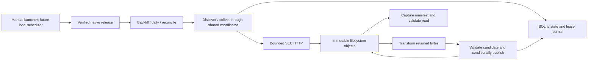

# SEC filing-index ingestion for sec-edgar-local — Design Spec

**Status:** Local documentation rewrite, 2026-10-18. The native implementation is complete;
operational coverage and the future scheduling phase have separate acceptance gates.
**Project:** `/Users/lowell/Projects/sec-edgar-local`.
**Roadmap:** [Local ingestion roadmap](sec-filing-index-ingestion-roadmap.md).

This document adapts the filing-index design from `sec-edgar` to the native local fork. It describes
the shipped manual ingestion contract and the remaining operational goals. The owner requested a
future local scheduling phase; its mechanism and operating policy still require design. This rewrite
does not implement or enable that phase, authorize live traffic, or reopen the retired port plan.

The [completed local design](completed/sec-edgar-local-spec.md),
[completed implementation plan](plans/completed/1-sec-edgar-local-spec.md), and
[final completion review](evidence/local-port/completion-review.md) establish the delivered baseline.
The final completion review controls status where dated intermediate evidence still says pending.
Accepted source-project Azure stages and approvals are not local completion evidence. Historical
acceptance records remain unchanged; current configuration is described separately in §4.8.

## 1. Purpose

Maintain a local filing-index catalog from a historical quarterly baseline and ongoing daily
indexes. Preserve exact source bytes, apply the same validation and ETL to both families, and
reconcile later quarterly corrections. Durable worksets and results support continuation after
failure; validated quarter generations provide reproducible reads.

Implementation readiness, bounded genuine acceptance, accepted historical coverage, and unattended
operation are different claims. The completed native port establishes the first two, within the
limits in §6. It does not establish the latter two.

## 2. Scope

### 2.1 Implemented scope

- Manual `backfill`, `daily`, and `reconcile` workflows using one downloader, parser, and publisher.
- Immutable originals and observations, strict normalization, per-quarter Parquet publication,
  source-level checkpoints, retained pending work, and exact result replay.
- Shared local request coordination, bounded native child execution, and durable recovery evidence.
- Explicit withdrawal approval, candidate inspection, history, recorded rollback, and validated reads.
- Immutable installed native releases, offline preflight, fixture proofs, and local invocation logs.

### 2.2 Remaining operational scope

- A bounded backfill campaign with an explicit coverage and exception decision.
- Accepted daily catch-up and an initial manual reconciliation with unresolved work accounted for.
- Future local scheduling of those existing workflows, including missed-run and observed-execution
  acceptance. Scheduler design and activation are separate from this document rewrite (§4.10).

### 2.3 Outside this contract

Individual filing-document downloads; Feed/Oldloads archives; submissions/companyfacts JSON; XBRL;
a search service or analytical warehouse; cloud deployment; Docker; distributed processing;
globally atomic multi-quarter publication; existing-store migration or relocation; garbage
collection; notification delivery; and an availability, freshness, runtime, or capacity guarantee.
The initial supported host is this Mac, CPython 3.14 on macOS arm64, on a native filesystem with
SQLite locking and atomic filesystem operations. Other operating systems, shared/network filesystems,
and synchronized data directories need separate validation or design.

## 3. Requirements

| ID | Local requirement | Contract |
|---|---|---|
| R1 | Baseline | Ingest an inclusive quarterly range, pinning `open` once per invocation; report coverage gaps. (§4.2) |
| R2 | Continuation | Discover daily indexes and catch up after outages without abandoning older pending work. (§4.2) |
| R3 | Processing | Strictly validate and normalize index metadata into `sec-index-v1` rows. (§§4.4–4.6) |
| R4 | Platform | Use a verified native installation, local filesystem objects, SQLite state, and local process supervision. (§§4.1, 4.9) |
| R5 | Shared implementation | Source selection varies by workflow; acquisition, ETL, publication, and checked-command contracts are shared. (§§4.1–4.2) |
| R6 | Replay and provenance | Retain original bytes and producer identities; exact retries preserve runtime, config, IDs, intent, and deadline. (§§4.5, 4.7, 4.9) |
| R7 | Corrections | Reconciliation refreshes quarterly sources, records changes, and preserves history and the last valid catalog on failure. (§§4.2, 4.4) |
| R8 | SEC access | All application SEC requests share one local coordinator and the accepted owner request policy. (§4.3) |
| R9 | Publication and reads | Publish validated immutable quarter generations using a conditional active pointer; readers capture exact manifests. (§4.6) |
| R10 | Withdrawal safeguards | Gate withdrawals on exact-candidate approval; retain explicit rollback and stale-approval checks. (§§4.4, 4.7) |
| R11 | Configuration and evidence | Strictly validate local config, preserve root/issuer binding, and archive effective config and process evidence. (§§4.7–4.8) |
| R12 | Verification and recovery | Preserve offline/genuine acceptance separation, checked child results, positive drain, and supported recovery procedures. (§§4.7, 6) |
| R13 | Future local scheduling | Design and validate local triggers for existing daily/reconciliation workflows before enabling unattended operation. (§4.10) |

R1–R12 describe the delivered implementation. Their operational use still needs §7 evidence.
R13 is future work; no scheduler, schedule config fields, or notifications are installed today.

## 4. Design

### 4.1 Components and execution boundary

| Component | Owns |
|---|---|
| `scripts/sec-edgar-local` and `scripts/local-bootstrap.py` | Config-based native release selection without checkout application imports. |
| Installed `sec_edgar_ingest.local_cli` | Preflight, fresh correlation IDs/deadline, normalized invocation snapshot, stream archives, and engine supervision. |
| Installed `sec-edgar-ingest` / `python -m sec_edgar_ingest` | Low-level commands and composed backfill/daily/reconciliation workflows. |
| `workflows/` | Frozen selections, checked child calls/results, source completion, unresolved work, and publication repair. |
| `download.py`, `coordination.py`, discovery/collection | Canonical SEC acquisition, bounded HTTP children, pacing, leases, retries, cooldown, and drainage. |
| `storage/local.py` | Filesystem object persistence and SQLite conditional state, journal, and local binding. |
| `etl/` | Retained-byte parsing, observations, candidates, publication, approval, rollback, and captured reads. |
| `runtime.py` / `release.py` | Native identity and verification; explicit release setup/reconstruction outside ingestion. |



There is one uv workspace package: distribution `sec-edgar-ingest`, import `sec_edgar_ingest`, version
`0.2.0`. The reviewed release uses Requests 2.34.2 and PyArrow 25.0.1 with exact locked transitives.
No Azure identities, ADF pipelines, Container Apps Jobs, ADLS, Table Storage, cloud alerts, container
image digest, or provider fallback participates in this local execution path.

### 4.2 Discovery and work selection

**Source families.** Follow validated `index.json` parent listings under canonical SEC HTTPS
`Archives/edgar/full-index/` and `Archives/edgar/daily-index/`. Supported bodies are quarterly
`master.zip` containing exactly `master.idx`, and daily `master.YYYYMMDD.idx`. Preserve source URL,
kind, period, representation, and the stable hash-derived source ID. Do not construct a presumed
“yesterday” body URL or treat a failed listing as empty.

**Backfill.** Discover the inclusive configured quarterly range. If it includes the current quarter,
use the supported quarter-to-date source, including the validated root bridge where applicable.
Collect or reuse accepted snapshots, transform, and publish affected filing quarters. Requested
source quarters and output filing-date quarters are distinct: an index may contain older filings.
Report missing source/publication evidence rather than assuming every requested quarter completed.

**Daily.** Discover the current and preceding quarter, the handoff/discovery-boundary catch-up
range, and quarters needed for pending sources or failed directories. A failed directory prevents
advancing its discovery boundary. `daily.start_date` is a handoff/discovery input, not a strict
body-date filter. A valid listing with no new work is distinct from discovery failure.

**Retained work.** New workflow invocations consider unresolved existing members as well as current
discovery. Quarterly discovery can therefore include daily sources retained in the same store;
`backfill` does not promise exactly one body per requested quarter. Reuse validated completed work
without hiding unresolved earlier units. Exact origin and repair contexts remain authoritative.

**Reconcile.** Discover supported quarterly sources and refresh their bytes instead of ordinary
accepted-snapshot reuse. Unchanged bytes and matching parser/schema avoid unnecessary processing;
changed bytes use the same strict parser and publication path. No automatic reconciliation schedule
exists yet. A newer download repeating superseded older bytes is reported as `source_reverted`,
not silently activated as a new correction.

### 4.3 Collection and request coordination

All listings, bodies, retries, and reconciliation requests use the shared accepted policy in §4.8.
Preserve the owner User-Agent, one active collector, request spacing, finite renewable leases,
fencing, conservative clock uncertainty, cooldown, and positive confirmation that an HTTP child
has drained before releasing unsafe ownership. Lease expiry or a dead parent alone is not drain
proof. An expired unsent permit is deferred work, not a completed acquisition.
At the next eligible turn, queued daily work takes priority over backfill/reconciliation; it does
not preempt an unsafe in-flight request or bypass pacing and drainage.

Only invocations sharing the same bound root share the pacing journal. Separate roots, machines,
and the original cloud project do not coordinate with this store. During live local operation,
other collectors for the accepted project budget must be stopped externally. The launcher cannot
inspect or enforce that declaration on other systems.

Stream and hash original response bytes with finite received/expanded limits. Validate completeness,
family envelope, and non-error content before accepting a snapshot. Preserve receipt time, byte
count, available validators, raw bytes, and refusal evidence. Parser failures preserve their input;
transform/publish use retained objects and do not acquire SEC data.

Live acquisition requires native runtime provenance and production parser settings. Fixture mode
requires an explicit validated fixture pack; missing fixture responses never fall back to the SEC.
Fixture clock/deadline exceptions remain individually explicit and are rejected in live mode.

### 4.4 Rows, identity, and correction rules

The published `sec-index-v1` row has ten fields:

| Field | Contract |
|---|---|
| `cik` | Non-null ten-digit normalized decimal string. |
| `company_name`, `form_type` | Non-null source values; no entity resolution or selected-form filter. |
| `filing_date` | Valid date determining the output quarter. |
| `archive_path` | Safe relative SEC Archives path, consistent with the row CIK where recognized. |
| `accession_number` | Nullable; extracted only from a recognized supported path. |
| `source_id`, `source_sha256` | The selected observation's exact source and body provenance. |
| `parser_version`, `schema_version` | Explicit processing versions. |

The logical key is `(cik, archive_path)`. Preserve original field values in observations. Identical
observations can collapse in the canonical catalog; conflicting duplicate keys within one source
quarantine the whole source. Amendments with different archive paths remain distinct. No malformed
row, empty source, unsupported ZIP layout, or conflict is silently dropped or assigned a winner.

Choose observations deterministically using quarterly precedence and retained source-period,
receipt-time, and source-identity rules. Same-source newer snapshots supersede older snapshots;
ambiguous receipt authority is refused. An archive-path change is an addition and a possible
withdrawal, not an inferred submission identity match.

Absence from an open-quarter or otherwise unauthoritative source does not remove an active key;
retain and report `unresolved_absence`. A validated closed-quarter quarterly replacement may
establish withdrawal authority, but a candidate removing keys remains `awaiting_approval` until
approval binds the exact candidate and quarterly hash. Keep the old generation active until then.
Stale approvals cannot authorize different bytes. Old daily observations cannot undo an activated
quarterly exclusion; a later valid quarterly reintroduction is recorded explicitly.

Each candidate includes before/after changes and provenance. Candidate inspection distinguishes
superseded work, and approval refuses stale/superseded authority. These are existing data-quality
rules, not decisions to relax during a large backfill or scheduling rollout.

### 4.5 Local persistence and durable formats

The resolved live root contains `state.sqlite3` and `objects/<logical-key>`, with SQLite WAL/SHM
files when present. State holds source/attempt records, conditional publication pointers,
approvals, workflow indexes, and the durable sentinel journal. Logical keys remain safe relative
POSIX paths with traversal/symlink defenses.

Representative object families are retained originals under `raw/sec/indexes/`, observations,
transformed worksets, immutable quarter generations/manifests/change reports under `curated/sec/`,
low-level results under `runs/sec/`, workflow selections/receipts, and refusal/quarantine evidence.
Read exact saved references and manifest file lists; these families are not a glob-based reader API.

Separate source identity, snapshot identity, immutable workset-to-snapshot binding, processing
identity, command attempt, generation pointer, and approval/rollback authority. Downloaded,
transformed, and published states remain distinct. An Attempt is admitted against its canonical
immutable command identity before it can gain execution authority.

Use the closed local formats from the [contract inventory](evidence/local-port/contract-inventory.json),
including `sec-local-run-context-v1`, `sec-local-acquisition-v1`, `sec-local-command-result-v1`,
`sec-local-attempt-admission-v1`, observation/transformed/generation/ETL formats, and local workflow
formats. Residual workflow envelopes require `contract_version=sec-local-contract-v1`. Preserve
unchanged source/raw identities, `sec-index-v1` rows, and compatible approval/rollback record shapes.
Old provider/image-based contracts are refused; no automatic old-store import or record relabeling
is supported.

The `sec-local-binding-v1` registry fixes the resolved root, acquisition mode, issuer namespace,
shared SEC/coordination policies, and local storage contract. It excludes release, parser, range,
and correlation IDs. A new release can therefore use the same valid root without rewriting its
binding. Fixture/live roots remain distinct. Initialized-store relocation is unsupported.

### 4.6 Transformation, publication, and reads

Write immutable observations keyed by exact source snapshot and parser/schema. Rebuild affected
quarters from accepted observations and the applicable quarterly authority. Matching fingerprints
and versions are a no-op; forced transformation never bypasses quarantine or withdrawal approval.

For each affected quarter, read the active pointer/version, construct a new immutable candidate,
validate explicit data/change files, hashes, row counts, schema, and logical-key uniqueness, apply
the withdrawal gate, then conditionally replace the active pointer. A conflict cannot overwrite
newer work. The pointer is the commit boundary; ancillary result/index completion is repairable
through checked publication after a crash.

Atomicity is per quarter, not across the complete historical catalog. Readers capture a generation
with `capture_quarter`, then use `read_quarter` to validate its manifest, files, and counts before
exposing rows. Retained captures remain stable when active pointers change. A reproducible
multi-quarter read records every capture; it does not scan all retained Parquet generations.

### 4.7 Invocation evidence, recovery, and operators

The manual launcher accepts `backfill`, `daily`, or `reconcile`, an explicit config, and a finite
timeout. It generates fresh IDs and UTC deadline, preflights the selected release, and retains
`invocation.json`, normalized `config.json`, `stdout.jsonl`, and `stderr.jsonl` under
`logs/<run-id>/<attempt-id>/`. Matching durable engine/child results establish completion; process
start, logs, output files, or pointer movement alone do not.

Structured `workflow_summary` events retain outcome/counts, member outcomes, gap codes,
`discovery_complete`, `boundary_after`, `oldest_unresolved_period`, `pending_approvals`,
`last_successful_reconcile_at`, and `summary_error`. Summary-enrichment failures are reported
separately and do not rewrite the durable result, stdout, or exit code. Future scheduling must
inspect this evidence without treating absent summary fields as successful completion.

Exact completed-result replay uses the original archived runtime/config/IDs/intent/deadline and
can return after expiry without HTTP. An unfinished expired attempt needs supported new-attempt
recovery; never extend its saved deadline. A new launcher invocation creates a new result and may
continue eligible unresolved work. A workflow run stops starting members at its deadline minus
`execution.dispatch_reserve_seconds`, records each member not started as pending
(`workflow_deferred`), and writes its durable result. So a deadline deferral reports exit 3 or 4.
A member already running at that time completes. (Stage 1a, plan 4.) Ambiguous child execution is
not permission for an automatic whole-worker relaunch. Interruption, deadline, and logging failures
retain status/drain evidence; required launcher logging failure returns 9 while preserving the
actual engine status where known.

Operator commands `candidates`, `history`, `approve`, and `rollback` verify an existing store without
initializing one. Approver/operator/reason labels are explicit audit text, not authenticated user
identity. Data rollback names exact from/to generations and is distinct from selecting a retained
code release. Neither erases history or retracts downstream exports.

Preserve evidence before recovery. Never manually edit pointers, relax parsing, delete partial
objects to reset state, or treat quarantine as successful coverage. Backups require stopped writers,
confirmed child drain, a consistent SQLite backup, matching immutable objects/binding, configs/logs,
and required releases. See [recovery](../docs/runbooks/local-recovery.md) and
[release upgrades](../docs/runbooks/release-upgrades.md).

### 4.8 Current configuration and limits

The live default is [conf/sec-edgar-local.json](../conf/sec-edgar-local.json), strict JSON with
`config_version=sec-local-config-v1`. Unknown/duplicate keys, invalid types/versions, disallowed
live overrides, or incompatible bindings fail before gaining store/network authority. Resolve
filesystem paths against the original config parent; retain the original byte hash separately
from the canonical normalized effective-config hash.

| Setting | Current value |
|---|---|
| Storage / acquisition | `storage.backend=local`; `acquisition.mode=live`. |
| Data root | `../data`, resolving to `/Users/lowell/Projects/sec-edgar-local/data`. |
| Logging root | `../logs`, resolving to `/Users/lowell/Projects/sec-edgar-local/logs`. |
| Backfill / handoff | `2015Q1` through `open`; daily handoff `2026-10-01`. |
| SEC identity | `Lowell Mason sec-edgar-ingest mason.lowell@mac.com`. |
| Request policy | 3 requests/second, one active collector. A lower positive rate is allowed. |
| HTTP attempts / retry delay | Five total; 2-second base, 120-second local cap with jitter; honor longer server delays. |
| Connect / read / exchange limits | 15 / 60 / 90 seconds. |
| Received / expanded limits | 67,108,864 / 536,870,912 bytes per response. |
| Coordination | Namespace `sec-owner-lowell-mason`; 60-second lease, 20-second renewal, 2-second uncertainty. |
| Parser / schema | `sec-index-parser-v1` / `sec-index-v1`. |
| Withdrawal approval | `reconciliation.require_withdrawal_approval=true`. |
| Execution | Live maximum 3,600 seconds; launcher default 3,300 seconds. |
| Dispatch reserve | `execution.dispatch_reserve_seconds=1800`. Required for a new live workflow run; floor 480 seconds (release constant), below `max_run_seconds`. The launcher refuses a timeout at or below the reserve. (Stage 1a, plan 4.) |
| Runtime | `kind=native`; explicit content-addressed `release_manifest`. |

The selected manifest is:

```text
/Users/lowell/Projects/sec-edgar-local/releases/sha256=aa8de1ac09fa8ef1a8f638301b25c370af5222e9ef0b02fd117866c2260a6ab4/release.json
```

Stage 1a (plan 4) selected the D5 release
`aa8de1ac09fa8ef1a8f638301b25c370af5222e9ef0b02fd117866c2260a6ab4` and added the dispatch reserve,
at commit `62ce1403f192ff18537d28842548af1be2ecfe57`. The effective-config SHA-256 is
`32e822323d24d2bb3ee41b53e7c3eb16082b7dc9059d6ba17c578dbdd1c0579e`, confirmed by offline preflight.
The earlier release-only edit that selected `fc68adef…` produced
`088403cb55f5b6541502cb07678c5757ffdb13b92fac52a52b6aa663177b7d4d`.
The config is tracked in git since commit `001edf5`; its effective-config hash is unchanged
(owner, plan 2, 2026-10-21). Acceptance-time statements that the preserved default selected
`900952a8…` describe the earlier bytes; they are not current release-selection instructions. Keep
those historical records and releases intact.

There are no `schedule`, `jobs`, `worker.image_digest`, or cloud orchestration keys in the current
config schema. The future scheduling phase must define its own reviewed configuration boundary;
do not insert unsupported scheduling fields into this live config.

### 4.9 Native releases and interfaces

Live execution uses the selected release's non-editable installed wheel at
`releases/sha256=<release-id>/venv`. Before the first application import, every native process uses
`-I -B -X pycache_prefix=/dev/null` or the reviewed equivalent isolated stdlib bootstrap. No checkout
application imports, ingestion-time dependency sync/install, or interpreter downloads are permitted.

A release retains its canonical manifest, application wheel/payload, exact dependency artifacts,
lock/export, installation receipt, and setup evidence. Identity includes Git revision, application
and dependency hashes, and exact interpreter/platform identity. `preflight_current` verifies both
the retained release and executing installation. Native descriptors use `sec-native-runtime-v1`
and `release_sha256`, not an image digest or a mutable `latest` alias.

Preserve original producer descriptors on cached artifacts. Historical reads validate saved
producer manifests without requiring the current release to equal the producer. Exact old retries,
origin-bound collection, and publication repair still need the saved release environment. Missing
old execution authority is a recovery failure; never substitute the new parent release.

Release `fc68adef…` refuses a config and a receipt that a D5 live run writes. Its settings reject the
unknown `execution.dispatch_reserve_seconds` key, and it reports a D5 sibling-completion receipt as
`legacy_member_unresolved`, so the run ends `incomplete` (exit 3). That it also refuses D5 child
results and contexts is an untested inference. After a D5 live run has written to a store, selecting
`fc68adef…` again for that store is unsupported. The D5 release continues `fc68adef…`-origin pending
work. (Stage 1a, plan 4; [two-release evidence](evidence/d5-release/two-release.md).)

The supervised entry point is `scripts/sec-edgar-local`. The installed engine exposes `discover`,
`collect`, `transform`, `publish`, `backfill`, `daily`, `reconcile`, `candidates`, `approve`, `history`,
and `rollback`. Low-level execution requires explicit config, IDs, deadline, and applicable exact
workset references. Use [manual ingestion](../docs/runbooks/local-ingestion.md) for invocation syntax
and [native setup](../docs/runbooks/native-setup.md) for explicit offline build/verification setup.

### 4.10 Future local scheduling

This is an unimplemented extension requested for the local roadmap. Select the scheduler and its
configuration/installation boundary in a stage-specific design; macOS `launchd` is a candidate,
not a settled or installed dependency. Reuse the existing launcher and current config rather than
building a second downloader or bypassing the native release/check-command boundary.

The design must settle:

- Invocation cadence and time zone for `daily` and `reconcile`. The parent design's 05:00 Eastern daily
  and Sunday 06:00 Eastern reconciliation times are proposals for review, not active schedules or
  source-publication guarantees. State daylight-saving behavior explicitly.
- Sleep, reboot, logout, network absence, missed triggers, overlapping invocations, and manual
  backfill interaction. Continue durable unresolved work; do not manufacture a last-success date
  or grant an expired/ambiguous attempt a blind relaunch.
- Execution identity, writable paths, config/release pinning, finite per-run deadlines, stdout/stderr
  retention, and how an operator detects and inspects a missed, failed, gated, or quarantined run.
  Notification transport remains outside scope unless separately requested.
- Installation in a disabled state, explicit per-workflow enable/disable records, and rollback to
  manual operation. Live invocations still require the external sole-issuer operating condition.

R13 acceptance requires scheduler-specific tests plus observed scheduler-triggered `daily` and `reconcile`
executions tied to durable workflow results and invocation logs. Exercise or explicitly record the
approved limits of missed-run, reboot/sleep, overlap, and DST behavior. A manual run, generated
schedule file, or successful scheduler installation alone cannot satisfy that gate. No schedule
may be marked accepted or enabled merely by approving this documentation rewrite.

## 5. Outcomes and recovery decisions

| Exit | Meaning and required distinction |
|---|---|
| 0 | Success, unchanged, or no new sources for that exact invocation. |
| 2 | Invalid configuration/input, refused operation, or unfinished expired deadline. |
| 3 | Incomplete/discovery failure. |
| 4 | Pending work. |
| 5 | Deferred, retry, or throttled work. |
| 6 | Access blocked; halt SEC access rather than rotate identities. |
| 7 | Whole-source quarantine/invalid source. |
| 8 | Lost ownership. |
| 9 | State/internal/publication conflict, or required launcher logging failure. |
| 10 | Awaiting exact withdrawal approval. |
| 11 | Stale approval or rollback. |

Inspect durable result gaps and actual process/drain evidence before choosing continuation or
recovery. A 404 remains pending/failure; a 403/access-denial body halts access; retryable failures
observe the configured bounds/cooldown. No failure or absence is authority for withdrawal. A
quarantine or partially published run stays nonzero, and successful later periods do not erase
older gaps. Acceptance-harness exit 12 is separate from this production CLI table.

## 6. Verification and existing evidence

The default checker [scripts/check-sec-edgar-ingest.sh](../scripts/check-sec-edgar-ingest.sh) is
offline: guard network access before test imports, use committed/synthetic/retained fixtures and
explicit loopback boundaries, verify installed native releases, build wheel/sdist, check CLI
interfaces, and validate source syntax. Explicit artifact setup precedes the gate; absent artifacts
fail rather than silently fetch or skip. It is not a live-store inspection command.

Preserve tests for discovery/outage coverage; strict rows and duplicate quarantine; shared pacing,
leases and drained HTTP children; immutable command admission and exact replay; conditional
publication and crash repair; approvals/reverts/rollback; captured reads; fixture/live isolation;
native tamper refusal and reconstruction; two-release continuation/repair; launcher signals,
logging failure and deadlines; and rejection of old/malformed contracts before mutation.

The final [completion review](evidence/local-port/completion-review.md) records renewed offline
L01–L11/L13 passing with **952 tests in 60 modules**. This is retained evidence of the completed
payload, not a suite run performed for this rewrite. Intermediate dated records retain their
original pending-review/L12-not-run statements.

The [genuine acceptance record](evidence/local-port/sec-acceptance.md) and
[machine evidence](evidence/local-port/sec-acceptance.json) establish L12 through a separately
reviewed offline adjudication of the same preserved bounded genuine attempt:

- Original driver run and original verification remain **incomplete, exit 12**.
- Separate reviewed supplemental analysis returned **pass, exit 0**, without repeating acquisition,
  resetting the window, changing parser rules, or overwriting the original records.
- The case made ten actual sends and settled nineteen reservations. Quarterly `2024Q1` remained
  quarantined; accepted daily `2026-10-14`/`2026-10-15` inputs produced 21 validated captured generations
  across 16 filing quarters. Latest captures total 6,744 rows; successive reads total 9,917 rows.
- **73 unselected discoveries remained pending.** Neither those counts nor the bounded pass prove
  full coverage of the configured historical range or readiness for unattended scheduling.

Retain the live root, releases, and committed evidence. The external directory
`/private/tmp/sec-local-task16-acceptance-20261018`, with the original results and separate supplement,
was found absent on 2026-10-21; its recorded hashes and inventory remain in the committed machine
evidence (owner, plan 2, 2026-10-21). Future operational reports add evidence;
they do not rewrite the acceptance attempt. Do not repeat acceptance to close a documentation gate.

## 7. Operational rollout and acceptance gates

| Gate | Required evidence | Current disposition |
|---|---|---|
| G1 — Native delivery | Completed local plan/reviews, renewed offline gate, bounded genuine evidence, and explicit reviewed release/config selection. | Implemented and evidenced; current selected release also passed offline preflight. |
| G2 — Baseline campaign | Exact range/config/release and per-invocation budgets; retained source/quarter results, validated captures, and a coverage report accounting for every requested unit and exception. | Not established by bounded acceptance; operational work remains. |
| G3 — Daily catch-up | Handoff/boundary/pending inventory, catch-up results and captures, unresolved gaps, and a recorded continuation decision. | Not established by the two selected daily acceptance bodies. |
| G4 — Manual reconciliation | A refresh under the selected native policy; reviewed additions/updates/withdrawal gates/reverts, exact approvals where needed, and retained results/captures. | Automated behavior is verified; a broad operational acceptance report remains. |
| G5 — Scheduled operation | Reviewed R13 design, disabled installation, explicit enablement, and observed scheduled runs plus recovery-policy evidence. | Future work; nothing installed or enabled. |

Run the stages in the roadmap, preserving the completed implementation as their input. Each live
campaign needs an explicit source scope, runtime/request/byte budget appropriate to that campaign,
retained evidence, and the sole-issuer declaration; the prior acceptance budget is not reusable
authority. The normal launcher bounds runtime and per-response bytes but does not impose the
external acceptance harness's aggregate URL/request budget automatically.

A coverage decision must distinguish complete coverage from an owner-approved incomplete range
with named quarantines, gaps, and downstream limitations. Approval of incomplete operation does
not convert refused rows or sources into accepted data. Do not infer completeness from an exit
code, latest filing date, directory presence, or one nonempty captured quarter.

## 8. Documentation and project boundaries

The [README](../README.md), [native setup](../docs/runbooks/native-setup.md),
[manual ingestion](../docs/runbooks/local-ingestion.md), [recovery](../docs/runbooks/local-recovery.md),
and [release upgrades](../docs/runbooks/release-upgrades.md) are operator entry points. Where older
status paragraphs describe the preselection default, use §4.8 for current selection and the final
completion review for acceptance status. Historical evidence is not edited to follow later state.

Keep new operational and future scheduling evidence separate from `specs/evidence/local-port/`'s
completed port record. Record exact release/config identities, invocation/result refs, captures,
exceptions, and approvals. Future scheduler configuration and its install/disable/recovery guide
belong to its reviewed implementation stage; no cloud infrastructure paths are required.

## 9. Decisions carried forward and replaced

Retain source-file checkpoints, immutable originals, shared acquisition/ETL, conservative correction
rules, conditional quarter publication, explicit approval/rollback, and captured reads. These
preserve the parent ingestion intent.

Replace cloud orchestration/identity/storage/image deployment with local launcher supervision,
SQLite/filesystem persistence, and content-addressed installed Python releases. The original
project remains the owner of its Azure implementation and stage history; its missing ADR/stage
links and deployment approvals are not dependencies of this checkout.

The native port is not a new parser policy, state migration, scheduler, or historical backfill
acceptance. Scheduling is a future extension; any parser/schema/runtime/storage change must
preserve the existing provenance and reader contracts or propose an explicit versioned transition.

## 10. Rollout note

This spec and [roadmap](sec-filing-index-ingestion-roadmap.md) replace the copied parent documents
in place for `sec-edgar-local`. They are a local description and proposed operational roadmap,
not a new implementation plan or retroactive acceptance stamp. The completed port design/plan
and all original acceptance evidence stay retired and unchanged.

The operational switch today is an explicit manual launcher invocation. Future scheduler
enablement is a separate switch with its own reviewed design and observed-run gate. No live
backfill, daily/reconciliation invocation, scheduler installation, or acceptance rerun is part
of this documentation rewrite.
